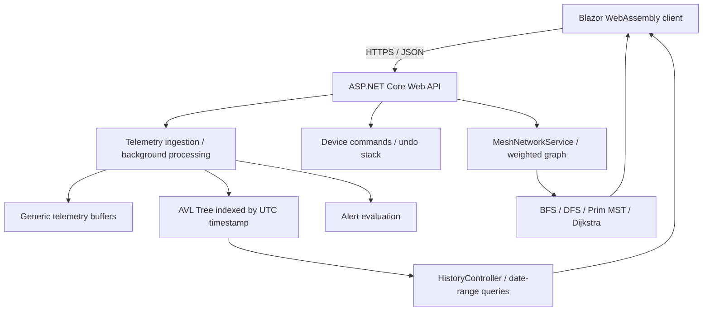
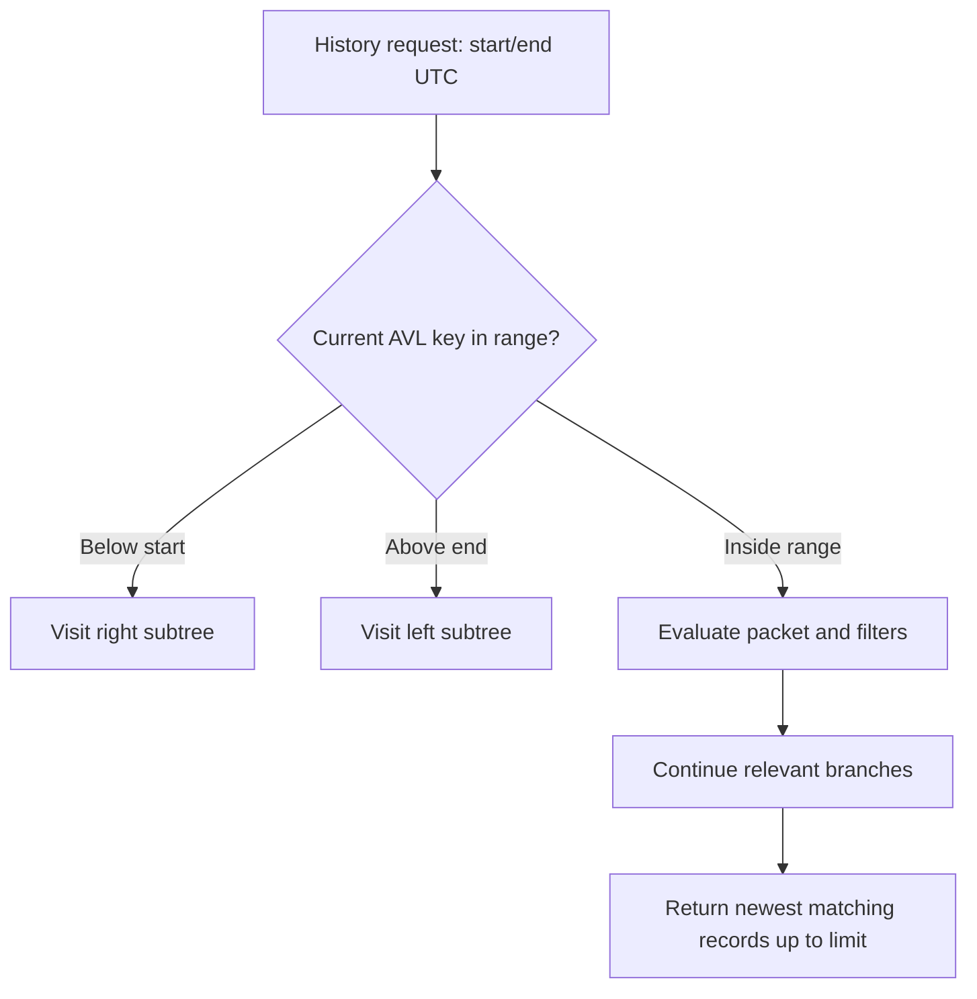
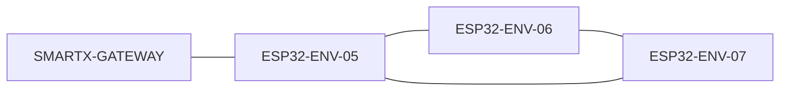

# Smart-X IoT Mesh Ecosystem

## PROG7312 - Portfolio of Evidence (POE) - Final Part 3

**Student:** Raghav Mahraj  
**Student Number:** ST10458336  
**Module:** PROG7312  
**Assessment:** Final POE - Part 3  
**Project:** Smart-X IoT Mesh Ecosystem  
**Technology:** C# / .NET 10 / ASP.NET Core Web API / Blazor WebAssembly  

### Demonstration Videos

| Assessment | YouTube demonstration |
|---|---|
| **Final POE - Part 3** | https://youtu.be/HlAc0mg8cM4 |
| **POE - Part 2** | https://www.youtube.com/watch?v=vk7PITxr740 |
| **POE - Part 1** | https://youtu.be/h0Ft0MrGIwk |

> Watch videos at the highest available quality. 

---

# Final Part 3 - Start Here

Smart-X is a simulated IoT management gateway that integrates **all three assessment phases** in one .NET solution. The final phase adds a **self-balancing AVL Tree** for historical telemetry queries and a **weighted graph** representing an ESP32 mesh network. The Blazor WebAssembly client exposes the three working modules through the startup gateway: **Telemetry** (`/dashboard`), **Command Stream & History** (`/commands`), and **Mesh Topology & Routing** (`/mesh`). The sidebar also exposes Historical Telemetry (`/history`).

**Latest verification reported by the developer (12 November 2026):** the solution builds, **146 of 146 automated tests pass**, and all three startup module links work. This is a development verification result, not a guarantee of marks.

## Quick Navigation

- [Quick Start: PowerShell and Visual Studio](#quick-start-powershell-and-visual-studio)
- [User Guide: Every Page](#user-guide-every-page)
- [Part 3 Architecture and Data Flow](#part-3-architecture-and-data-flow)
- [Part 3 Implementation A: AVL Tree](#part-3-implementation-a-avl-tree)
- [Part 3 Implementation B: ESP32 Mesh Graph](#part-3-implementation-b-esp32-mesh-graph)
- [Part 3 API and Source Code Map](#part-3-api-and-source-code-map)
- [Part 3 Verification and Demonstration](#part-3-verification-and-demonstration)
- [Automated Tests and Evidence](#automated-tests-and-evidence)
- [Changes and Improvements Across Parts](#changes-and-improvements-across-parts)
- [Complexity, Trade-offs and Limitations](#complexity-trade-offs-and-limitations)
- [Troubleshooting and Common Issues](#troubleshooting-and-common-issues)
- [Assessment and Submission Checklist](#assessment-and-submission-checklist)
- [Previous README - Parts 1 and 2](#previous-readme-parts-1-and-2)

---

# Quick Start: PowerShell and Visual Studio

## Prerequisites

- Windows with **Visual Studio 2026** and the ASP.NET/web development workload.
- **.NET 10 SDK**, Git, and a modern browser.
- Internet access on first restore for NuGet packages.
- PowerShell or the Visual Studio integrated terminal.
- Postman is optional; no physical ESP32 devices, database server, Node.js server, Docker container or separate message broker is required for the demonstrated in-memory simulation.

## 1. Clone and open

```powershell
git clone https://github.com/Raghav-10458336/PROG7312-POE-Part-1-SmartX-IoT-Mesh-Ecosystem.git
cd PROG7312-POE-Part-1-SmartX-IoT-Mesh-Ecosystem\PROG7312.POE.Part1
```

Open `PROG7312.POE.Part1.sln` in Visual Studio. If the repository is already cloned, open the existing solution instead; **do not reclone over local work**. Check out the branch containing the final Part 3 submission and confirm the branch name on GitHub before assessing.

## 2. Trust the local HTTPS development certificate (first-time setup)

```powershell
dotnet dev-certs https --trust
```

Accept the Windows certificate prompt. This enables HTTPS development on localhost; it does not deploy the application publicly.

## 3. Configure the attachment encryption key (first-time setup)

From the solution directory:

```powershell
cd .\SmartX.Api
dotnet user-secrets init
$key = [Convert]::ToBase64String([Security.Cryptography.RandomNumberGenerator]::GetBytes(32))
dotnet user-secrets set "AttachmentEncryption:MasterKey" "$key"
cd ..
```

**Never commit the generated key.** This configuration is needed for encrypted attachment functionality. The exact existing project settings should be retained; do not replace the key on an installation that needs to decrypt older attachments.

## 4. Restore, build and test

```powershell
dotnet restore .\PROG7312.POE.Part1.sln
dotnet build .\PROG7312.POE.Part1.sln
dotnet test .\PROG7312.POE.Part1.sln
```

Alternatively, in Visual Studio use **Build → Build Solution** and **Test → Run All Tests**. The last reported complete test run passed **146/146** tests; compare your local result with the current branch and environment.

## 5. Start BOTH applications

**Recommended - Visual Studio:** right-click the solution → **Configure Startup Projects** → **Multiple startup projects** → set `SmartX.Api` and `SmartX.Client` to **Start** → run the solution. `SmartX.Shared` and `SmartX.Tests` are not web servers and should not be started as separate applications.

**Alternative - two PowerShell terminals** (both commands run from the solution directory):

**Terminal A - API (start this first):**

```powershell
dotnet run --project .\SmartX.Api\SmartX.Api.csproj --launch-profile https
```

**Terminal B - Blazor client:**

```powershell
dotnet run --project .\SmartX.Client\SmartX.Client.csproj --launch-profile https
```

If the HTTPS launch profile has a different name in the checked-out version, inspect `Properties/launchSettings.json` and use that exact name. Avoid launching an extra duplicate API process if Visual Studio is already running it.

| Application | Development URL | Purpose |
|---|---|---|
| API | `https://localhost:7113` | REST endpoints, telemetry ingestion, history, commands, alerts, mesh algorithms |
| Blazor client | `https://localhost:7292` | User interface, dashboards, filters, visualisations |

The above are the documented Part 2 HTTPS addresses; confirm the current `launchSettings.json` if a port differs. Open the **client** URL in the browser. Keep both server processes running. The API starts the mock seeder and mesh topology initialiser automatically; **no additional seeder command** is required.

## 6. Expected initial state

- **24 registered simulated sensors**: eight environmental, eight power and eight actuator devices.
- **6,000 startup telemetry readings**: 2,400 float, 2,000 integer and 1,600 Boolean packets.
- Startup dashboard shows **03 / 03 active modules**.
- Module cards navigate to `/dashboard`, `/commands` and `/mesh`.
- Historical Telemetry uses the API's in-memory AVL index.

> Important: `MockTelemetrySeeder.Seed()` executes at API startup, not on a recurring timer. Most seeded timestamps cluster around startup time; three intentionally older sensor timestamps model disconnections. Restarting the API recreates in-memory data. This is expected and is not a historical-query defect.

---

# User Guide: Every Page

| Page / workspace | What it does | Typical user action |
|---|---|---|
| **Home / Smart-X Gateway** (`/`) | Gateway status, sensor and packet counts, three assessment modules | Select Telemetry, Commands or Mesh; verify `03 / 03` active |
| **Operations Dashboard** (`/dashboard`) | Part 1 gateway overview and access to monitoring functions | Review gateway statistics and navigate to management pages |
| **Sensors** | Registry of simulated ESP32 devices, locations and categories | Register a device, inspect details, verify duplicate protection, remove a test device |
| **Telemetry** | Submit and inspect float, integer and Boolean readings; filters and power analysis | Choose a registered sensor, metric, unit and value; submit and refresh |
| **Attention Centre** (`/alerts`) | Warning/critical conditions, connectivity faults and acknowledgements | Inspect a fault, acknowledge an alert, distinguish active faults from historical alerts |
| **Attachments** | Upload and list encrypted sensor-associated files | Select a sensor, upload a supported file (maximum 10 MB), inspect the stored attachment |
| **Deployment Validation** | Recursively validates a nested facility/zone/sensor hierarchy | Submit valid and invalid nested configurations and compare results |
| **Command Stream & History** (`/commands`) | Part 2 device lookup, simulated Pump/Relay/Valve control, command history, Undo and suggested actions | Select an active device, confirm an override, inspect history, Undo |
| **Historical Telemetry** (`/history`) | Part 3 AVL-backed time-range queries with device/metric filters | Choose UTC start/end, filter, Apply, Reset, inspect newest matching records |
| **Mesh Topology** (`/mesh`) | Part 3 graph visualisation, connectivity, MST, shortest paths and failure/recovery | Select nodes, compare routes, inspect reachability, simulate failure and recovery |

**Navigation:** the three home cards are high-level entry points, not the only pages. Use the management sidebar to reach supporting pages. The exact sidebar label may differ slightly from the page title.

## Suggested first-time walkthrough

1. Open `/` and check **Gateway Online**, **24 sensors**, **6,000 packets**, **03 / 03 modules**.
2. Select **Sensor Data Ingestion & Telemetry**; inspect Sensors, Telemetry and Attention Centre.
3. Return home and open **Real-Time Command Stream & History**; inspect an active device and test a reversible command.
4. Open **Historical Telemetry**; select a UTC range containing the seeded readings and apply device/metric filters.
5. Return home and open **Network Topology & Mesh Routing**; inspect graph nodes, BFS, Prim MST and Dijkstra routes.
6. Demonstrate a node or link failure, then restore it before ending the demo.
7. Open Visual Studio Test Explorer and show the passing test suite.

---

# Part 3 Architecture and Data Flow



**Project responsibilities:**

- `SmartX.Api` - HTTP controllers, simulation, ingestion, historical indexing and graph algorithms.
- `SmartX.Client` - Blazor pages, dashboard cards, filters and network visualisation.
- `SmartX.Shared` - telemetry packets, models, enums and shared types.
- `SmartX.Tests` - automated regression, data-structure and algorithm tests.

## Data lifecycle

```text
API startup → MockTelemetrySeeder.Seed()
    → 24 device registrations + 6,000 simulated packets
    → TelemetryIngestionService.IngestFloat/Integer/Boolean
    → generic telemetry buffers + alert evaluation
    → HistoricalTelemetryService.AddFloat/Integer/Boolean
    → AvlTree<DateTime, object>.Insert(timestampUtc, packet)

Later UI/API POST → TelemetryQueueService
    → TelemetryProcessingWorker (asynchronous)
    → TelemetryIngestionService → same buffers / alerts / AVL history

History page → GET /api/history/recent?... → AVL reverse range traversal
    → device/metric filtering → bounded newest-first results → table
```

Mesh topology is initialised separately during API startup through `MeshTopologyInitializer`. Mesh nodes and weighted links model the logical network rather than actual radio transmissions.

---

# Part 3 Implementation A: AVL Tree

## Requirement and design choice

Part 3 requires a binary search tree, AVL Tree or Red-Black Tree to index **timestamped historical telemetry** and efficiently retrieve records in a specified time interval. Smart-X implements a **generic self-balancing AVL Tree** (`SmartX.Api/DataStructures/AvlTree.cs`) and uses it inside `HistoricalTelemetryService`.

An AVL Tree is a binary search tree where the height difference between a node's left and right subtrees is at most one. Rotations maintain balance after insertion, avoiding the long linear chains that can form in an ordinary unbalanced BST.

**Index:** `AvlTree<DateTime, object>` - the UTC timestamp is the ordering key; the value is a telemetry packet. A node stores a **list of values** so multiple readings with identical timestamps are preserved rather than overwritten.

## AVL rotations

```text
LL imbalance (right rotation)       RR imbalance (left rotation)
       30                                     10
      /                                        \
     20               => 20                   20       => 20
    /                   /  \                    \         /  \
   10                  10  30                    30      10  30

LR: rotate left on the left child, then right on the node.
RL: rotate right on the right child, then left on the node.
```

## Historical insertion example

The following is an illustrative excerpt matching the integration pattern, not a verbatim copy of the service source:

```csharp
private readonly AvlTree<DateTime, object> _history = new();

public void AddFloat(TelemetryPacket<float> packet)
{
    lock (_sync)
    {
        _history.Insert(packet.TimestampUtc, packet);
    }
}
```

`HistoricalTelemetryService` similarly handles `TelemetryPacket<int>` and `TelemetryPacket<bool>`. The shared singleton instance means the telemetry ingestion service and history controller operate on the same index. Access is synchronised with a lock around tree operations.

## Range and recent queries

- `GetAll()` returns records in sorted timestamp order.
- `GetRange(startUtc, endUtc)` returns readings in the **inclusive** interval, pruning branches whose keys cannot match.
- `GetRecent(startUtc, endUtc, limit, predicate)` walks matching timestamps **newest first**, applies optional device/metric filtering **before** the limit, and returns a bounded result.
- Duplicate timestamps are supported; all readings stored under a matching key remain eligible.
- The API validates reversed date ranges and invalid limits; `recent` defaults to 50 and accepts 1–100.



## Complexity and efficiency

| Operation | AVL expectation | Explanation |
|---|---|---|
| Insert | `O(log n)` | Height remains logarithmic through rotations |
| Find a timestamp | `O(log n)` | BST comparisons discard subtrees |
| Range query | `O(log n + k)` typical | Reach first relevant key and visit `k` returned records; additional work depends on traversal/filtering |
| Retrieve newest `k` | Approximately `O(log n + k)` when records qualify | Reverse traversal can stop early after the limit; selective filters may require inspecting more candidates |
| Memory | `O(n)` | In-memory nodes plus packet references |

These are algorithmic characteristics, not measured timings. The tests include larger datasets, but the README does **not** claim unrecorded benchmark measurements.

## How to demonstrate the AVL Tree

1. Start the API and open **Historical Telemetry**.
2. Set a UTC range that contains the startup readings; click **Apply** and observe rows.
3. Narrow the range to exclude the readings; observe an empty result.
4. Restore the range; enter `ESP32-ACT-07` and confirm only that device appears.
5. Select an appropriate metric; confirm only matching records appear.
6. Explain that the table shows a **bounded recent result**, not necessarily the total history size.
7. Show `AvlTree.cs`, `HistoricalTelemetryService.cs`, `HistoryController.cs` and passing AVL tests.

**Time-zone note:** South Africa Standard Time is UTC+2. If a table renders local time, `17:13` local corresponds to `15:13 UTC`; use the page's UTC filter labels and inspect the actual timestamp conversion before concluding a filter is wrong.

**Seeder limitation:** most startup readings are assigned `DateTime.UtcNow` within seconds of each other. Three devices are deliberately assigned older timestamps (`ESP32-ENV-08`: −35 minutes, `ESP32-PWR-07`: −27 minutes, `ESP32-ACT-06`: −22 minutes). The seeder was intentionally left unchanged to preserve connectivity-alert behaviour. A separate AVL visualiser page is **not required** for the implemented time-range querying interface.

---

# Part 3 Implementation B: ESP32 Mesh Graph

## Requirement and representation

The final phase models the ESP32 network as a **weighted graph**: devices and the gateway are vertices, while communication links are edges with numerical weights. Weights represent the simulated routing cost used by the algorithms; they are not measured radio power consumption or real network latency.

`MeshNetworkService` contains the graph and traversal/routing operations. `MeshTopologyInitializer` creates the initial network. The Blazor `Mesh.razor` page renders the topology and its algorithm results.



*Illustrative subgraph only, not the complete topology. Actual available nodes, links and weights come from the running `MeshNetworkService`.*

## Breadth-First Search (BFS)

BFS explores neighbouring nodes level by level using a queue. It identifies **reachability** and can produce parent links or a minimum-hop path in an unweighted interpretation of the graph. A node disconnected from the gateway cannot be reached by BFS. Complexity is `O(V + E)` for vertices `V` and edges `E`.

## Depth-First Search (DFS)

DFS follows a branch as deeply as possible before backtracking, using recursion or a stack. It supports graph traversal and connectivity analysis. Complexity is `O(V + E)`. **DFS does not by itself guarantee the fewest hops or minimum weighted route.**

## Prim's Minimum Spanning Tree (MST)

Prim's algorithm grows a spanning tree by repeatedly choosing a minimum-weight edge that connects the current tree to an unvisited vertex. For a connected weighted graph, the result connects every node without cycles and minimises the **sum of included edge weights**. For a disconnected graph, a single spanning tree cannot cover every vertex. Complexity depends on the chosen implementation; a heap-based adjacency-list implementation is typically `O(E log V)`.

**Interpretation:** the MST provides a low-total-cost network backbone, **not** necessarily the shortest route from every sensor to the gateway. It is a simulation of efficient topology design, not proof of measured battery savings.

## Dijkstra's shortest-path algorithm

Dijkstra finds a minimum-total-weight path from a selected source when edge weights are **non-negative**. It serves a different goal from the MST: optimising an individual route rather than the cost of connecting the entire graph.

A verified example from the application's mesh testing was:

| Route | Path | Hops | Total weight |
|---|---|---:|---:|
| Dijkstra | `ESP32-ENV-07 → ESP32-ENV-05 → SMARTX-GATEWAY` | 2 | 5.0 |
| Route along MST | `ESP32-ENV-07 → ESP32-ENV-06 → ESP32-ENV-05 → SMARTX-GATEWAY` | 3 | 5.5 |

This example illustrates why **MST routing and shortest-path routing are not interchangeable**. It is a previously observed example; recheck the current graph if topology state has changed.

## Failure and recovery simulation

The Mesh page allows simulated **node failures**, **link failures** and recovery. These operations change the available topology and therefore can change reachability, highlighted paths and spanning-tree results. Restore failed nodes/links before concluding the demonstration. These simulations do not disable physical ESP32 hardware.

## How to demonstrate the graph algorithms

1. Open **Mesh Topology** from the third startup card.
2. Show the nodes, gateway and weighted links; select a node and inspect its details.
3. Run/inspect **BFS reachability** and its parent connections.
4. Inspect the **Prim MST** highlighting and total cost where displayed.
5. Select a source/destination and inspect the **Dijkstra** route; compare with the MST route.
6. Simulate a node or link failure; explain which paths or connectivity results change.
7. Recover the failed element and confirm the network representation updates.
8. Show `MeshNetworkServiceTests.cs` to demonstrate algorithm-level verification.

---

# Part 3 API and Source Code Map

## Part 3 source files

```text
PROG7312.POE.Part1/
├── SmartX.Api/
│   ├── DataStructures/
│   │   └── AvlTree.cs
│   ├── Controllers/
│   │   ├── HistoryController.cs
│   │   └── [Mesh controller / route implementation - inspect source]
│   ├── Services/
│   │   ├── HistoricalTelemetryService.cs
│   │   ├── MeshNetworkService.cs
│   │   ├── MeshTopologyInitializer.cs
│   │   ├── TelemetryIngestionService.cs
│   │   └── MockTelemetrySeeder.cs
│   └── Program.cs
├── SmartX.Client/
│   └── Pages/
│       ├── Home.razor
│       ├── History.razor
│       └── Mesh.razor
├── SmartX.Shared/
└── SmartX.Tests/
    ├── AvlTreeTests.cs
    ├── AvlTreePerformanceTests.cs
    ├── HistoricalTelemetryTests.cs
    ├── HistoricalTelemetryExtendedTests.cs
    └── MeshNetworkServiceTests.cs
```

The exact mesh HTTP controller filename/routes were not supplied in the reviewed excerpts, so **verify them in the submitted source** rather than treating an invented endpoint as fact. All other named Part 3 classes above are grounded in the implementation reviewed during development.

## Verified historical telemetry endpoints

| Method | Route | Function |
|---|---|---|
| GET | `/api/history` | All indexed history |
| GET | `/api/history/device/{deviceIdentifier}` | History for a device |
| GET | `/api/history/range?startUtc=...&endUtc=...` | Inclusive UTC time range |
| GET | `/api/history/recent?startUtc=...&endUtc=...&limit=50&device=...&metric=...` | Newest matching records, optional filters, bounded limit |

Example (replace dates with a period that actually contains readings):

```http
GET /api/history/recent?startUtc=2026-11-12T14:00:00Z&endUtc=2026-11-12T16:00:00Z&limit=50&device=ESP32-ACT-07
```

A query with a historical date will return no rows after a later API restart unless the new seeded readings fall in that period. Do not treat a sample date as a permanent fixture.

---

# Part 3 Verification and Demonstration

| Check | Expected observation | Evidence |
|---|---|---|
| Startup integration | All three module cards ACTIVE; `03 / 03` | Home page screenshot |
| Telemetry | 24 initial sensors and 6,000 startup packets | Gateway metrics and API |
| AVL insertion | Float/int/Boolean packets appear in history | History service and tests |
| AVL range query | Inclusive interval returns matching records | History UI/API + tests |
| Filter exclusion | Outside interval returns empty result | History UI screenshot |
| Device/metric filter | Only matching rows returned | History UI screenshot |
| BFS/DFS | Connectivity/traversal handles reachable and unreachable nodes | Graph tests / mesh page |
| Prim MST | Highlighted low-total-weight spanning structure | Mesh UI and algorithm tests |
| Dijkstra | Lowest-weight route, distinct from MST route when appropriate | Mesh UI and tests |
| Failure/recovery | Graph results update when nodes/links change | Mesh UI demonstration |
| Regression | Parts 1 and 2 remain accessible | Navigation and commands demonstration |
| Automated tests | Full suite passes | Visual Studio Test Explorer |

## Recommended final demo order

1. Show project title, author and repository.
2. Start API and client; show both running terminals or Visual Studio startup configuration.
3. Show all three active cards and the gateway counts.
4. Briefly demonstrate Part 1 Telemetry and Part 2 Commands/Undo to prove integration.
5. Open Historical Telemetry; demonstrate inclusive/exclusive time ranges and device/metric filtering.
6. Explain AVL balancing, duplicate timestamp handling, `GetRange` pruning and `GetRecent` reverse traversal using source code.
7. Open Mesh; show weighted graph, BFS connectivity, Prim MST, Dijkstra route and a failure/recovery.
8. Explain the difference between minimum spanning cost and shortest route.
9. Show **146 passing tests**, the README and Git history.
10. End with limitations and future improvements.

---

# Automated Tests and Evidence

**Most recent verified development run:** **146 passed / 146 total, 0 failed, 0 skipped**, followed by a successful final build and a user-confirmed working dashboard and navigation. Test counts are a snapshot of the final development run; rerun tests against the submitted commit.

The test project includes the following known test classes:

| Test file | Main purpose |
|---|---|
| `AvlTreeTests.cs` | Insertion, ordering, duplicates, range behaviour and rotation cases |
| `AvlTreePerformanceTests.cs` | Large ascending/reverse insert sequences, 10,000-reading history workloads, recent/range retrieval; diagnostic timing without fragile timing thresholds |
| `HistoricalTelemetryTests.cs` | Historical service operations |
| `HistoricalTelemetryExtendedTests.cs` | Additional history and filtering scenarios |
| `MeshNetworkServiceTests.cs` | Graph traversal, MST, shortest routes and failure/recovery (22 test cases reported) |
| `DeviceCommandServiceTests.cs` | Simulated command processing and Undo |
| `DeviceCommandExtendedTests.cs` | Additional command scenarios |
| `SensorRegistryExtendedTests.cs` | Registration and lookup |
| `TelemetryAlertExtendedTests.cs` | Alerts and active-fault logic |
| `TelemetryQueueTests.cs` | Standard and priority queue operations |
| `TelemetryQueueExtendedTests.cs` | Extended queue behaviour |

**Important:** the 146 count is the entire suite, **not 146 AVL tests**. The AVL performance tests exercise 10,000-element datasets but do not establish a guaranteed millisecond bound. No measured performance values are invented here.

### Reproduce results

```powershell
dotnet test .\PROG7312.POE.Part1.sln --configuration Debug
```

For assessor evidence, capture a Test Explorer screenshot showing total, passed and failed counts, and (if requested) a terminal screenshot of the successful build. The latest developer-reported Test Explorer run displayed one warning; its origin was not investigated, so do not claim a warning-free run without checking.

---

# Changes and Improvements Across Parts

| Phase | Delivered capability | Structures / techniques |
|---|---|---|
| **Part 1** | Sensor registration, telemetry ingestion, monitoring, alerts, attachments, recursive deployment validation | Generics, jagged arrays, collections, recursion, operator overloading |
| **Part 2** | Asynchronous telemetry queues, device command execution and Undo, device lookup, unique faults, rule-based recommendations, ordered history | FIFO queue, priority queue, stack, dictionary, `HashSet`, `SortedDictionary` (historical Part 2 design) |
| **Final Part 3** | AVL-backed historical time-range queries; graph-based mesh topology, connectivity and routing; third active home card | AVL Tree with rotations; BFS, DFS, Prim MST, Dijkstra; weighted graph; failure/recovery |

**Specific Part 3 updates:**

- Added `AvlTree<TKey,TValue>` with balancing rotations and duplicate-key values.
- Connected `HistoricalTelemetryService` to the AVL Tree rather than relying on the earlier sorted-dictionary historical index.
- Preserved the ingestion pipeline so new readings reach history and alert evaluation.
- Exposed range/recent history operations through `HistoryController` and the existing History UI.
- Added/expanded AVL and historical test coverage, including 10,000-record workloads.
- Added mesh network model, topology initialisation, traversal, MST and shortest-route logic.
- Added the Mesh page and network failure/recovery interactions.
- Updated `Home.razor`: third card now **ACTIVE**, links to `/mesh`, and the summary shows **03 / 03**.
- Confirmed successful build, full passing suite and all three home navigation paths.
- Deliberately **did not modify** `MockTelemetrySeeder.cs` merely to spread timestamps, because its older sensor timestamps also support connectivity-alert simulation.

## Project challenges, decisions and learning outcomes

- **Preserving existing behaviour:** new structures were integrated behind existing services and controllers rather than rewriting stable Part 1/2 features.
- **Duplicate timestamps:** multiple rapidly seeded packets can share a timestamp; a list per AVL node avoids losing records.
- **Balancing correctness:** LL/RR/LR/RL rotations and large insertion patterns need direct unit tests rather than relying on the UI.
- **Time-zone interpretation:** UTC filters and local display time can look inconsistent unless converted correctly.
- **Graph optimisation goals:** minimum total network weight (MST) differs from minimum individual route cost (Dijkstra).
- **Network failures:** graph connectivity and routing must respond to disabled nodes/links without corrupting the original topology.
- **Regression safety:** 146 passing tests and the final dashboard check reduce risk, though they cannot prove every possible runtime scenario.

---

# Complexity, Trade-offs and Limitations

| Decision | Benefit | Trade-off |
|---|---|---|
| AVL Tree instead of unsorted list | Efficient timestamp ordering and selective range traversal | Rotation logic and extra node metadata |
| AVL Tree instead of earlier sorted dictionary | Explicitly demonstrates self-balancing tree architecture required by Part 3 | Requires custom implementation and tests |
| Weighted graph | Expresses connectivity and routing cost clearly | Edge weights are simulated rather than measured radio metrics |
| BFS/DFS | Straightforward connectivity and traversal | Not weighted-shortest-path optimisers |
| Prim MST | Minimises total cost of a spanning network | Does not minimise every individual route |
| Dijkstra | Finds lowest-weight individual route | Assumes non-negative edge weights |
| In-memory state | Simple, fast, no database dependency for assessment | Data, commands and changes reset when the API restarts |
| Startup mock seeding | Reproducible 24-device / 6,000-packet demo | Most timestamps are close together; no continuous sensor generator |

## Technology recommendations and justification

**Current choices:** .NET 10 and C# provide strong typing, generic data structures, asynchronous background services, dependency injection and a shared model library. ASP.NET Core Web API cleanly separates server algorithms from the browser UI. Blazor WebAssembly enables a unified C# client and server development workflow. MSTest and Visual Studio Test Explorer support repeatable regression verification. Git/GitHub provide change history and submission traceability.

**Potential future improvements (not claimed as implemented):**

1. **Persistent history** using PostgreSQL/SQL Server or a time-series database, with an appropriate timestamp index and retention policy; current AVL storage is volatile.
2. **Live ESP32 transport** using MQTT and a broker such as Mosquitto/EMQX, with device authentication and TLS; current network is simulated.
3. **Realistic routing metrics** from observed signal strength, energy use, packet loss and latency; current graph weights are illustrative.
4. **Observability** with structured logging, health checks and metrics; useful for diagnosing background processing and disconnected nodes.
5. **Authentication/authorisation** for administrative controls and encrypted attachment access before production deployment.
6. **Automated CI** to build and run tests on pull requests, if not already configured on the final branch.

These are recommendations, not features that the assessment version currently implements.

## Lecturer feedback and iteration log

The submitted material does not include the lecturer's exact feedback text or dates. **Do not fabricate feedback.** Complete the following table from actual feedback and the corresponding commits before submission:

| Date / phase | Actual lecturer feedback | Change made | Evidence (commit / screenshot) |
|---|---|---|---|
| Part 1 review | [INSERT EXACT FEEDBACK] | [INSERT VERIFIED CHANGE] | [INSERT EVIDENCE] |
| Part 2 review | [INSERT EXACT FEEDBACK] | [INSERT VERIFIED CHANGE] | [INSERT EVIDENCE] |
| Part 3 review (if applicable) | [INSERT EXACT FEEDBACK OR N/A] | [INSERT VERIFIED CHANGE OR N/A] | [INSERT EVIDENCE] |

---

# Troubleshooting and Common Issues

| Symptom | Likely cause | Fix |
|---|---|---|
| Client shows **Gateway Offline** | API not running / wrong API URL | Start `SmartX.Api` first; inspect launch profile and client `HttpClient` base URL |
| Browser shows HTTPS certificate warning | Untrusted local development certificate | Run `dotnet dev-certs https --trust` and restart browser |
| Client loads but requests fail | API/CORS/port mismatch | Confirm client `https://localhost:7292`, API `https://localhost:7113`, and the API CORS configuration |
| `dotnet` not recognised | SDK missing or terminal PATH not refreshed | Install .NET 10 SDK; reopen PowerShell; run `dotnet --info` |
| NuGet restore fails | Connectivity or package source problem | Check network/NuGet sources; rerun `dotnet restore` |
| Port already in use | Another API/client instance running | Stop duplicate Visual Studio/PowerShell process or inspect launch settings |
| 24 sensors / 6,000 packets appear again | API restarted and re-seeded | Expected for in-memory demo; restart resets prior changes |
| History shows no results | UTC range excludes timestamps or filters too restrictive | Reset filters; use current startup time; account for UTC+2 when comparing display |
| History timestamps look identical | Startup seeder creates packets rapidly | Expected; inspect date/device/metric queries or submit a new reading |
| Newly submitted reading not visible immediately | `202 Accepted` means queued, not yet processed | Wait briefly, refresh history/telemetry and confirm API still runs |
| Mesh route disappears | Node/link was simulated as failed, or destination unreachable | Restore nodes/links; rerun the relevant algorithm |
| Prim MST differs from Dijkstra | Different optimisation objectives | MST minimises overall spanning cost; Dijkstra minimises individual route cost |
| Mesh card does not navigate | Incorrect route or stale client build | Confirm `Home.razor` links to `/mesh` and `Mesh.razor` declares that route; rebuild |
| Attachment upload fails | Missing key, unsupported type, oversized file or invalid sensor | Configure User Secrets; check supported extensions, 10 MB limit and sensor selection |
| Test suite fails | Different code branch, build issue or shared test state | Restore/build; inspect failing assertion; rerun full suite |

**If a feature seems broken:** first check whether both projects are running, the browser is on the client URL, and the selected date/device/route inputs match the currently seeded simulation. Avoid changing the seeder or algorithms until the failure is reproduced.

---

# Assessment and Submission Checklist

## Final Part 3 rubric coverage

| Area | Marks | Evidence / status |
|---|---:|---|
| AVL Tree and historical telemetry range queries | 30 | AVL source, history API/UI, unit and larger-workload tests |
| Mesh graph, traversal and MST routing | 30 | Mesh source, graph page, BFS/DFS/Prim, Dijkstra extension, graph tests |
| README and technical explanations | 10 | This document, algorithms, code examples, setup and user guide |
| Project completion report | 10 | **Separate report still required if specified by the brief**; README contains supporting summary |
| Technology recommendations | 5 | Recommendations section above |
| Technology justification | 5 | .NET/C#/Blazor/API and testing rationale above |
| Lecturer feedback incorporation | 5 | **Complete feedback table with genuine evidence** |
| Main menu integration | 5 | `03 / 03` active; three working module links |
| **Total** | **100** | Final marking determined by assessor |

## Before submitting

- [x] Final dashboard shows all three modules as active (developer-confirmed).
- [x] Final solution builds successfully (developer-confirmed).
- [x] Full suite passed 146/146 in latest reported run.
- [x] All three dashboard links worked in latest manual verification.
- [ ] Confirm the correct **final Part 3 branch** and GitHub URL (do not submit an older `part2/main` snapshot).
- [ ] Push this updated README and verify Markdown tables, diagrams and code blocks render on GitHub.
- [ ] Add Final Part 3 and Part 1 YouTube links above.
- [ ] Record exact lecturer feedback and associated changes/commits.
- [ ] Complete any separately required project completion PDF/report.
- [ ] Verify required minimum commit count (25+ where specified) on the submitted history.
- [ ] Verify no secrets, `EncryptedUploads`, `bin` or `obj` folders were committed.
- [ ] Record final test screenshot, application screenshots and video evidence.
- [ ] Verify any additional assessment-specific submission instructions and deadlines.

---

# Previous README - Parts 1 and 2

> **Historical documentation preserved below.** The following is the earlier Part 2 README retained for completeness and traceability. Its descriptions of **Part 3 as “coming soon”**, **`02 / 03` active modules**, the **Part 2 `SortedDictionary` historical index**, **Part 2-specific commit counts/branch names**, and **Part 2 assessment status** describe the *previous submission*, not the current Final Part 3 application. For the current architecture, setup, user guide, AVL implementation, mesh graph and final verification, use the **Final Part 3 sections above**. The historical Part 2 video URL remains valid as supplied.

---

# Project Overview

Smart-X is an IoT management gateway developed for **PROG7312 POE Parts 1 and 2**. Part 2 extends the original telemetry gateway with command execution, real-time monitoring, historical telemetry, advanced collections and rule-based operational insights.

The system is designed to model a distributed IoT environment in which devices such as ESP32 microcontrollers continuously transmit different forms of telemetry to a central gateway.

Example Smart-X deployment environments include:

- Hydroponic farming systems
- Automated utility monitoring
- Smart building infrastructure
- Power-consumption monitoring
- Distributed environmental sensing
- Automated actuator systems

IoT devices can transmit different data types depending on their purpose. Smart-X therefore supports environmental, power-consumption and actuator telemetry through a strongly typed .NET architecture.

The Part 1 implementation focuses on the first Smart-X management pillar:

> **Sensor Data Ingestion and Telemetry**

The platform is organised into three pillars:

- **Sensor Data Ingestion and Telemetry** - implemented in Part 1 and retained.
- **Real-Time Command Stream and History** - implemented in Part 2.
- **Network Topology and Mesh Routing** - reserved for the final POE; not represented as a completed Part 2 module.

---

# System Architecture

Smart-X follows a web-based client/API architecture consisting of an ASP.NET Core backend, a Blazor WebAssembly frontend, a shared model library and an automated test project.

```text
┌─────────────────────────────────────────────┐
│            SmartX.Client                    │
│         Blazor WebAssembly                  │
│                                             │
│  Dashboard • Sensors • Telemetry • Alerts   │
│  Attachments • Deployment Validation        │
└─────────────────────┬───────────────────────┘
                      │
                      │ HTTPS / REST API
                      │ JSON
                      ▼
┌─────────────────────────────────────────────┐
│              SmartX.Api                     │
│         ASP.NET Core Web API                │
│                                             │
│  Telemetry Ingestion                        │
│  Sensor Registry                            │
│  Alert Processing                           │
│  Attachment Storage                         │
│  Deployment Validation                      │
│  Power Analysis                             │
└─────────────────────┬───────────────────────┘
                      │
                      ▼
┌─────────────────────────────────────────────┐
│             SmartX.Shared                   │
│        Shared .NET Class Library            │
│                                             │
│  Models • Generics • Collections            │
│  Validation • Enums                         │
└─────────────────────────────────────────────┘
```

## SmartX.Api

The ASP.NET Core Web API acts as the central Smart-X gateway.

It is responsible for:

- Receiving telemetry packets
- Processing typed telemetry
- Maintaining the sensor registry
- Providing telemetry data to the frontend
- Detecting anomalous sensor readings
- Detecting sensor connectivity problems
- Managing alert acknowledgement
- Processing power-reading comparisons
- Validating nested deployment structures
- Receiving and protecting sensor attachments
- Generating the simulated IoT workload
- Queuing incoming telemetry and processing it through a hosted background worker
- Executing simulated Pump, Relay and Valve commands with Undo
- Maintaining timestamp-ordered telemetry history and unique active faults

## SmartX.Client

The Blazor WebAssembly application provides the Smart-X management interface.

It communicates asynchronously with the Web API and provides interfaces for:

- Gateway monitoring
- Sensor registration and management
- Telemetry submission
- Telemetry inspection and filtering
- Power-load analysis
- Alert investigation
- Alert acknowledgement
- Sensor attachment uploads
- Deployment validation
- Device controls, command history and Undo
- Historical telemetry and rule-based suggested actions

## SmartX.Shared

The shared class library contains reusable models and application logic required across the solution.

This prevents common structures from being unnecessarily duplicated between the API and frontend.

---

# Technology Stack

| Technology | Purpose |
|---|---|
| .NET 10 | Application framework |
| C# | Primary programming language |
| ASP.NET Core Web API | Backend IoT gateway |
| Blazor WebAssembly | Web management interface |
| HTML / CSS | Interface structure and styling |
| REST | Client/API communication |
| JSON | API data exchange |
| HTTPS | Secure API communication |
| AES | Protection of stored attachments |
| Git | Version control |
| GitHub | Source repository |
| Postman | API testing |
| Visual Studio 2026 | Development environment |

---

# Project Structure

The current repository contains four .NET projects under `PROG7312.POE.Part1/`. The tree lists the actual API controllers and services, client pages, shared types and test files in the submitted ZIP (build artifacts omitted).

```text
PROG7312-POE-Part-1-SmartX-IoT-Mesh-Ecosystem/
├── README.md
└── PROG7312.POE.Part1/
    ├── PROG7312.POE.Part1.sln
    ├── SmartX.Api/
    │   ├── Controllers/
    │   │   ├── AlertsController.cs
    │   │   ├── AttachmentsController.cs
    │   │   ├── CommandsController.cs
    │   │   ├── DeploymentController.cs
    │   │   ├── HistoryController.cs
    │   │   ├── PowerAnalysisController.cs
    │   │   ├── SensorsController.cs
    │   │   └── TelemetryController.cs
    │   ├── Services/
    │   │   ├── AttachmentStorageService.cs
    │   │   ├── DeviceCommandService.cs
    │   │   ├── HistoricalTelemetryService.cs
    │   │   ├── MockTelemetrySeeder.cs
    │   │   ├── SensorRegistryService.cs
    │   │   ├── TelemetryAlertService.cs
    │   │   ├── TelemetryIngestionService.cs
    │   │   ├── TelemetryProcessingWorker.cs
    │   │   └── TelemetryQueueService.cs
    │   ├── Properties/launchSettings.json
    │   ├── Program.cs
    │   └── SmartX.Api.csproj
    ├── SmartX.Client/
    │   ├── Layout/
    │   │   ├── MainLayout.razor
    │   │   └── SmartXSidebar.razor
    │   ├── Pages/
    │   │   ├── Alerts.razor
    │   │   ├── Attachments.razor
    │   │   ├── Commands.razor
    │   │   ├── Dashboard.razor
    │   │   ├── Deployment.razor
    │   │   ├── History.razor
    │   │   ├── Home.razor
    │   │   ├── NotFound.razor
    │   │   ├── Sensors.razor
    │   │   └── Telemetry.razor
    │   ├── wwwroot/css/
    │   ├── Program.cs
    │   └── SmartX.Client.csproj
    ├── SmartX.Shared/
    │   ├── Enums/SensorCategory.cs
    │   ├── Models/
    │   │   ├── DeploymentNode.cs
    │   │   ├── DeviceCommand.cs
    │   │   ├── PowerAnalysisResult.cs
    │   │   ├── PowerReading.cs
    │   │   ├── SensorAttachment.cs
    │   │   ├── SensorRegistration.cs
    │   │   └── TelemetryAlert.cs
    │   ├── Telemetry/
    │   │   ├── TelemetryBatch.cs
    │   │   ├── TelemetryBuffer.cs
    │   │   └── TelemetryPacket.cs
    │   ├── Validation/DeploymentValidator.cs
    │   └── SmartX.Shared.csproj
    └── SmartX.Tests/
        ├── DeviceCommandServiceTests.cs
        ├── DeviceCommandExtendedTests.cs
        ├── HistoricalTelemetryTests.cs
        ├── HistoricalTelemetryExtendedTests.cs
        ├── SensorRegistryExtendedTests.cs
        ├── TelemetryAlertExtendedTests.cs
        ├── TelemetryQueueTests.cs
        ├── TelemetryQueueExtendedTests.cs
        ├── MSTestSettings.cs
        └── SmartX.Tests.csproj
```

The client also includes component-specific `.razor.css` stylesheets. The API stores encrypted attachments in an excluded runtime directory, not as source files.

---

# Core Features

Smart-X Part 1 provides the following functionality:

- Professional Smart-X startup gateway
- Sensor registration and management
- Environmental telemetry ingestion
- Power telemetry ingestion
- Actuator telemetry ingestion
- Strongly typed generic telemetry packets
- High-volume mock IoT telemetry generation
- Jagged-array telemetry batching
- Generic telemetry collections
- Filterable telemetry monitoring
- Bounded telemetry retrieval
- Power-load analysis using operator overloading
- Automatic anomaly detection
- Sensor connectivity monitoring
- Alert acknowledgement
- Secure sensor attachment upload
- Encrypted attachment storage
- Recursive deployment hierarchy validation
- Responsive management dashboard

---

# Sensor Registration

Smart-X maintains a registry of IoT devices known to the gateway.

Each sensor registration contains:

- Unique device identifier
- Deployment location
- Sensor category
- Registration timestamp
- Active status

Three sensor categories are supported:

```text
Environmental
Power Consumption
Actuator
```

Example registered devices include:

```text
ESP32-ENV-01
ESP32-PWR-01
ESP32-ACT-01
```

Each device is also associated with a deployment location, for example:

```text
Hydroponic Zone 1
Utility Node 1
Actuator Node 1
```

The Sensor Registry interface supports:

- Creating sensor registrations
- Viewing registered sensors
- Selecting a sensor category
- Duplicate device identifier protection
- Input validation
- Removing sensors
- Delete confirmation before removal

---

# Telemetry Ingestion

Smart-X supports three telemetry data types.

| Sensor Type | C# Type | Example Metrics |
|---|---|---|
| Environmental | `float` | Soil Moisture, Temperature, Humidity |
| Power | `int` | Power Draw, Energy Usage, Flow Rate |
| Actuator | `bool` | Valve State, Pump State, Relay State |

The frontend provides a telemetry ingestion interface that allows a registered sensor to be selected and a reading submitted to the gateway.

The correct telemetry endpoint is selected according to the telemetry type.

```text
POST /api/telemetry/float
POST /api/telemetry/integer
POST /api/telemetry/boolean
```

The interface validates telemetry before submission.

For example:

- A sensor must be selected.
- A telemetry metric must be selected.
- A unit must be provided.
- Float telemetry accepts decimal values.
- Integer telemetry requires whole-number values.
- Boolean telemetry accepts true/false states.

A successful `POST` returns `202 Accepted` because the packet has been **queued**. `TelemetryProcessingWorker` subsequently dequeues and processes it; allow a brief delay before expecting the count, history and alert state to update.

---

# Mock IoT Deployment

Smart-X simulates a distributed IoT deployment so that the data structures and gateway can be demonstrated under a substantial telemetry workload without requiring physical microcontrollers.

The simulated deployment contains:

| Sensor Category | Registered Devices |
|---|---:|
| Environmental | 8 |
| Power Consumption | 8 |
| Actuator | 8 |
| **Total** | **24** |

At startup, the gateway seeds:

| Telemetry Type | Packets |
|---|---:|
| Float | 2,400 |
| Integer | 2,000 |
| Boolean | 1,600 |
| **Total** | **6,000** |

The mock data contains realistic variation across metrics and also introduces controlled abnormal readings.

This allows telemetry ingestion, collection processing, anomaly detection and dashboard behaviour to be demonstrated against thousands of readings.

---

# Generics

Smart-X uses a reusable generic telemetry packet:

```csharp
TelemetryPacket<T>
```

The generic type allows one telemetry structure to safely represent multiple underlying data types.

Examples include:

```csharp
TelemetryPacket<float>
TelemetryPacket<int>
TelemetryPacket<bool>
```

A packet contains information such as:

```text
Packet ID
Sensor ID
Device Identifier
Metric Name
Unit
Value
Timestamp
```

Using `TelemetryPacket<T>` avoids creating separate packet models for every telemetry primitive while retaining strongly typed values.

---

# Jagged Arrays and Collections

Smart-X uses jagged arrays when generating sequential batches of raw telemetry.

Examples include:

```csharp
TelemetryPacket<float>[][]
TelemetryPacket<int>[][]
TelemetryPacket<bool>[][]
```

These arrays model multiple batches of readings arriving from distributed IoT devices.

The generic:

```csharp
TelemetryBatch<T>
```

class processes these raw batches and converts them into collections for ingestion.

Telemetry is subsequently maintained using the reusable:

```csharp
TelemetryBuffer<T>
```

structure.

This provides a clear processing path:

```text
IoT Readings
      ↓
Jagged Telemetry Batches
      ↓
TelemetryBatch<T>
      ↓
Generic Collections
      ↓
TelemetryBuffer<T>
      ↓
Gateway API
```

---

# Operator Overloading

The `PowerReading` model demonstrates C# operator overloading for power telemetry.

The following operators are implemented:

```text
+
-
>
<
```

The Smart-X Telemetry interface includes a Power Load Analysis section.

Two power readings can be submitted to the API:

```text
Meter A
Meter B
```

The backend creates `PowerReading` objects and processes them using the overloaded operators.

The result provides:

- Meter A reading
- Meter B reading
- Combined power load
- Difference between readings
- Highest-load meter

For example:

```text
Meter A:          1,400 W
Meter B:          1,890 W
Combined Load:    3,290 W
Load Difference:    490 W
Highest Load:     Meter B
```

This demonstrates operator overloading as part of the running Smart-X system.

---

# Recursive Deployment Validation

IoT installations can contain multiple nested deployment levels.

For example:

```text
Facility A
└── Hydroponic Zone
    └── Sub-Zone
        └── Sensor Node
```

Smart-X represents this hierarchy using:

```csharp
DeploymentNode
```

Each deployment node can contain a collection of child nodes.

The:

```csharp
DeploymentValidator.ValidateNode()
```

method recursively traverses the deployment hierarchy.

The validation process checks the current node and then recursively validates each child until the complete hierarchy has been inspected.

If any nested node is invalid or incorrectly configured, the complete deployment is considered invalid.

The Deployment Validation interface allows this behaviour to be tested through the frontend and API.

---

# Attention Centre

Smart-X includes a dedicated **Attention Centre** for abnormal IoT conditions.

Instead of requiring an operator to manually inspect thousands of telemetry packets, incoming telemetry is evaluated against defined operational thresholds.

Examples of monitored conditions include:

### Environmental

- Low soil moisture
- Excessive temperature
- Low humidity

### Power and Utility

- Excessive power draw
- Excessive energy usage
- Abnormal flow rate

### Connectivity

- Sensors that have stopped reporting telemetry


Alerts are classified by severity:

```text
Critical
Warning
```

The Attention Centre displays:

- Total alerts
- Alerts requiring attention
- Critical alerts
- Warnings
- Device identifier
- Affected metric
- Alert description
- Detection time
- Acknowledgement state

---

# Alert Acknowledgement

Alerts requiring operator attention can be acknowledged from the Attention Centre.

When an alert is acknowledged:

- The alert remains available in the alert collection.
- Its acknowledgement status is updated.
- The acknowledgement timestamp is recorded.
- It is removed from the active attention-required count.

This provides a practical workflow for reviewing abnormal IoT conditions instead of simply displaying passive warning messages.

---

# Sensor Connectivity Monitoring

Smart-X also monitors simulated device connectivity.

The gateway evaluates when telemetry was last received from registered sensors.

If a device has not reported telemetry within the configured connectivity threshold, a critical connectivity alert can be generated.

An example connectivity alert is:

```text
ESP32-ENV-08 at Hydroponic Zone 8 has not reported telemetry
for approximately 35 minutes.
```

Connectivity alerts are identified using the:

```text
Sensor Connectivity
```

metric.

This makes communication failures clearly distinguishable from abnormal telemetry values.

---

# Telemetry Monitoring and Filtering

The Telemetry Stream provides a central interface for inspecting readings processed by the gateway.

Operators can filter telemetry by:

- Device
- Metric
- Telemetry type

Supported telemetry types include:

```text
Environmental
Power
Actuator
```

Boolean values are converted into meaningful operational states.

Examples include:

```text
Valve State: Open / Closed
Pump State: Running / Stopped
Relay State: Enabled / Disabled
```

The interface also displays the timestamp associated with each reading.

---

# Bounded Telemetry Retrieval

The gateway contains thousands of telemetry packets, but the frontend does not need to retrieve the complete workload every time the Telemetry page is opened.

The telemetry API therefore supports bounded retrieval using the `take` parameter.

Examples:

```http
GET /api/telemetry/float?take=250
GET /api/telemetry/integer?take=250
GET /api/telemetry/boolean?take=250
```

The API validates the requested amount and limits `take` to:

```text
1 - 1000
```

Requests outside the supported range are rejected with an HTTP `400 Bad Request`.

This prevents unnecessarily large telemetry responses and keeps the management interface responsive.

---

# Telemetry Summary

A lightweight summary endpoint provides gateway workload totals without requiring the client to retrieve all stored packets.

```http
GET /api/telemetry/summary
```

Example response:

```json
{
  "totalPackets": 6000,
  "floatPackets": 2400,
  "integerPackets": 2000,
  "booleanPackets": 1600
}
```

The original total-count endpoint is also available:

```http
GET /api/telemetry/count
```

---

# Secure File Attachments

Smart-X allows supporting files to be associated with registered sensors.

Examples include:

- Device configuration files
- Hardware logs
- Deployment photographs
- Diagnostic information
- PDF documentation
- Spreadsheet records

Supported file extensions include:

```text
.txt
.log
.json
.xml
.csv
.pdf
.docx
.xlsx
.jpg
.jpeg
.png
```

The maximum accepted file size is:

```text
10 MB
```

The attachment interface allows an operator to:

1. Select a registered sensor.
2. Select a supported file.
3. Upload the attachment through the API.
4. View files associated with the selected sensor.
5. Confirm that the file is stored in encrypted form.

---

# Attachment Security

Uploaded sensor records are protected through several controls.

## HTTPS Transport

The Blazor client communicates with the Smart-X API using HTTPS during development.

This protects data while it is transmitted between the client and gateway.

## Encrypted Storage

Uploaded files are encrypted before being stored by the gateway.

Stored files are placed in:

```text
SmartX.Api/EncryptedUploads/
```

The original file contents are therefore not stored as ordinary plaintext files.

## Generated Storage Names

Physical files are stored using generated identifiers rather than directly trusting the original user-supplied filename.

## File Validation

The API validates:

- Selected sensor
- File existence
- File size
- File extension

## Source Control Exclusion

The `EncryptedUploads` directory is excluded through `.gitignore`.

Uploaded files are therefore not committed to the Git repository.

---

# Encryption Key Configuration

The attachment encryption master key is intentionally **not stored in the repository**.

The application reads the key using the configuration path:

```text
AttachmentEncryption:MasterKey
```

For local development, the key is stored using **.NET User Secrets**.

The actual secret value must not be added to:

```text
README.md
appsettings.json
source code
Git commits
```

A local encryption key can be configured from the `SmartX.Api` project directory.

Initialize User Secrets:

```bash
dotnet user-secrets init
```

Generate a random 256-bit key using PowerShell:

```powershell
[Convert]::ToBase64String(
    [Security.Cryptography.RandomNumberGenerator]::GetBytes(32)
)
```

Then save the generated value:

```bash
dotnet user-secrets set "AttachmentEncryption:MasterKey" "YOUR-GENERATED-BASE64-KEY"
```

The private development key is deliberately excluded from this repository.

---

# API Endpoints

## Sensor API

### Retrieve all sensors

```http
GET /api/sensors
```

### Retrieve a sensor

```http
GET /api/sensors/{id}
```

### Register a sensor

```http
POST /api/sensors
```

### Remove a sensor

```http
DELETE /api/sensors/{id}
```

---

## Telemetry API

### Submit environmental telemetry

```http
POST /api/telemetry/float
```

### Submit power telemetry

```http
POST /api/telemetry/integer
```

### Submit actuator telemetry

```http
POST /api/telemetry/boolean
```

### Retrieve environmental telemetry

```http
GET /api/telemetry/float
```

Optional bounded request:

```http
GET /api/telemetry/float?take=250
```

### Retrieve power telemetry

```http
GET /api/telemetry/integer
```

Optional bounded request:

```http
GET /api/telemetry/integer?take=250
```

### Retrieve actuator telemetry

```http
GET /api/telemetry/boolean
```

Optional bounded request:

```http
GET /api/telemetry/boolean?take=250
```

### Retrieve total packet count

```http
GET /api/telemetry/count
```

### Retrieve telemetry summary

```http
GET /api/telemetry/summary
```

---

## Alert API

### Retrieve alerts

```http
GET /api/alerts
```

### Retrieve alert counts

```http
GET /api/alerts/count
```

The alert API also supports the acknowledgement operation used by the Attention Centre.

---

## Power Analysis API

```http
GET /api/power-analysis?meterA={value}&meterB={value}
```

Example:

```text
/api/power-analysis?meterA=1400&meterB=1890
```

---

## Deployment Validation API

```http
POST /api/deployment/validate
```

The request contains the root deployment node and its nested child hierarchy.

---

## Attachment API

### Upload attachment

```http
POST /api/sensors/{sensorId}/attachments
```

The file is submitted as multipart form data.

### Retrieve sensor attachments

```http
GET /api/sensors/{sensorId}/attachments
```

---

# Application Setup

## Requirements

Before running the solution, ensure the following are installed:

- Visual Studio 2026
- .NET 10 SDK
- Git
- Modern web browser

Postman can also be used for direct API testing.

---

## Step 1 - Clone the Repository

Clone the repository using Git:

```bash
https://github.com/Raghav-10458336/PROG7312-POE-Part-1-SmartX-IoT-Mesh-Ecosystem
```

Alternatively, clone the repository through Visual Studio or GitHub Desktop.

---

## Step 2 - Open the Solution

Navigate to the cloned repository and open:

```text
PROG7312.POE.Part1/PROG7312.POE.Part1.sln
```

using Visual Studio 2026.

---

## Step 3 - Restore Dependencies

Visual Studio should restore required NuGet packages automatically.

Dependencies can also be restored manually from the solution directory:

```bash
dotnet restore
```

---

## Step 4 - Configure the Encryption Key

Navigate to:

```text
SmartX.Api
```

Initialize User Secrets if they have not already been initialized:

```bash
dotnet user-secrets init
```

Generate a 256-bit Base64 key in PowerShell:

```powershell
[Convert]::ToBase64String(
    [Security.Cryptography.RandomNumberGenerator]::GetBytes(32)
)
```

Store the generated key:

```bash
dotnet user-secrets set "AttachmentEncryption:MasterKey" "YOUR-GENERATED-BASE64-KEY"
```

Do not place the real key in `appsettings.json`.

---

## Step 5 - Configure Startup Projects

Both the API and frontend must run for the complete application.

In Visual Studio:

1. Right-click the solution.
2. Select **Configure Startup Projects**.
3. Select **Multiple startup projects**.
4. Set `SmartX.Api` to **Start**.
5. Set `SmartX.Client` to **Start**.
6. Leave `SmartX.Shared` without a startup action.
7. Apply the configuration.

---

## Step 6 - Build the Solution

From Visual Studio:

```text
Build → Build Solution
```

Alternatively:

```bash
dotnet build
```

The application projects and automated test project should compile successfully.

---

# Running the Application

Start the solution using Visual Studio.

The development configuration currently uses:

### Smart-X API

```text
https://localhost:7113
```

### Smart-X Client

```text
https://localhost:7292
```

The browser should open the Smart-X gateway startup interface.

If the browser does not open automatically, navigate to the client address manually.

---

# Application Navigation

The startup interface displays the three Smart-X platform modules.

Select:

```text
Sensor Data Ingestion & Telemetry
```

to enter the original operations dashboard.

Part 2 also enables the Real-Time Command Stream and History module, providing access to device controls, command processing, operational history and suggested actions.

The management workspace provides access to the existing Part 1 functionality:

```text
Dashboard
Sensors
Telemetry
Attention Centre
Attachments
Deployment Validation
```

The Part 2 workspace extends the system with:

```text
Command Stream
Historical Telemetry
Suggested Actions
Manual Device Controls
Command History
```

The Network Topology and Mesh Routing module remains reserved for the final POE.

---

# Testing the Application

The following sequence can be used to verify the original Smart-X functionality retained from Part 1.

## 1. Verify Startup Data

After starting the API, confirm that the gateway contains:

```text
24 registered sensors
6,000 telemetry packets
```

---

## 2. Test Sensor Registration

Open:

```text
Sensors
```

Register a new device with:

- Device identifier
- Deployment location
- Sensor category

Confirm that:

- The sensor appears in the registry.
- The sensor count increases.
- Duplicate identifiers are rejected.
- Delete confirmation is displayed before removing a sensor.

---

## 3. Test Telemetry Ingestion

Open:

```text
Telemetry
```

Select:

- Telemetry type
- Registered sensor
- Metric
- Unit
- Value

Submit the reading.

Confirm that:

- The gateway returns `202 Accepted` for the queued reading.
- The telemetry count increases.
- The new reading appears in the telemetry stream.

---

## 4. Test Telemetry Filtering

Use the Telemetry Stream filters to search by:

- Device identifier
- Telemetry type
- Metric

Confirm that the displayed readings update according to the selected filters.

---

## 5. Test Power Analysis

Enter values for:

```text
Meter A
Meter B
```

Select:

```text
Analyse load
```

Confirm that Smart-X returns:

- Combined load
- Load difference
- Highest-load meter

---

## 6. Test Anomaly Detection

Submit a telemetry reading that exceeds one of the configured thresholds.

Examples include:

```text
Soil Moisture < 20%
Temperature > 38 °C
Humidity < 25%
Power Draw > 4500 W
Energy Usage > 5500 Wh
Flow Rate > 350 L/h
```

Open the Attention Centre and confirm that the corresponding alert is displayed.

---

## 7. Test Alert Acknowledgement

Open:

```text
Attention Centre
```

Select an unacknowledged alert and acknowledge it.

Confirm that:

- The alert is marked as acknowledged.
- The active Attention Required count decreases.
- The alert remains part of the overall alert collection.

---

## 8. Test Sensor Attachments

Open:

```text
Attachments
```

1. Select a registered sensor.
2. Choose a supported file.
3. Upload the file.
4. Confirm the successful upload message.
5. Confirm the attachment appears under the selected sensor.

The encrypted physical file can be found locally under:

```text
SmartX.Api/EncryptedUploads/
```

The stored file should not contain the original readable plaintext content.

---

## 9. Test Deployment Validation

Open:

```text
Deployment Validation
```

Submit a valid nested deployment hierarchy and confirm that the gateway reports it as valid.

Then mark a nested node as incorrectly configured and validate again.

The complete hierarchy should be reported as invalid because recursive validation reaches the incorrectly configured child node.

---

# HTTP Response Behaviour

The API uses standard HTTP responses where appropriate.

Examples include:

| Status | Meaning |
|---|---|
| `200 OK` | Request completed successfully |
| `201 Created` | Resource successfully created |
| `202 Accepted` | Telemetry accepted for ingestion |
| `400 Bad Request` | Invalid request or validation failure |
| `404 Not Found` | Requested resource does not exist |
| `409 Conflict` | Duplicate resource conflict |

---


# Part 2 Overview and Scope

Part 2 develops the gateway from an ingestion-focused application into a real-time monitoring and simulated device-control environment. The original Part 1 features remain available; the Part 2 work is additive.

The principal operator workflows are:

1. Inspect the registered sensor estate and live telemetry stream.
2. Find a device using its identifier, location, category or active-fault state.
3. Inspect the device's current Pump, Relay and Valve states.
4. Request a manual override, review a confirmation dialog and execute the command through the API.
5. Inspect the command stack and undo the most recent command.
6. Review historical telemetry by UTC date range, device and metric.
7. Investigate proactively identified recurring sensor conditions and active faults through contextual links.

The system uses simulated devices and telemetry. **Manual overrides modify simulated gateway state; they do not operate physical equipment.** Network Topology and Mesh Routing is reserved for the final POE.

## Part 2 Application Architecture

```text
Blazor WebAssembly Client
  ├── Command Stream & History (/commands)
  │     ├── Device search and operational filters
  │     ├── Manual override and confirmation
  │     ├── Live telemetry and current readings
  │     ├── Suggested actions
  │     └── Command history and Undo
  ├── Historical Telemetry (/history)
  │     └── UTC date, device and metric filters
  └── Attention Centre (/alerts)
        └── Prioritised faults and acknowledgement
                  │
                  │ HTTPS / JSON
                  ▼
ASP.NET Core Web API
  ├── Sensor registration and lookup
  ├── Telemetry ingestion and processing
  ├── Command state, execution and undo
  ├── Historical telemetry retrieval
  └── Alert detection and acknowledgement
                  │
                  ▼
In-memory simulated device and telemetry data
  ├── Queue<T> / priority queue
  ├── Stack<T>
  ├── Dictionary<TKey, TValue>
  ├── SortedDictionary<TKey, TValue>
  └── HashSet<T>
```

The client communicates with the API asynchronously. Device commands and Undo are handled by backend endpoints rather than only changing a visual state in the browser.

---

# Real-Time Command Stream and Device Control

Navigate to **Command Stream & History** from the sidebar, or open `/commands` on the client.

## Registered Device Stream

The device panel shows registered devices and their deployment locations. Operators can:

- Search by device identifier or location.
- Filter by operational category.
- Filter by active, inactive or active-fault state.
- Select a device explicitly; a single search result can be selected automatically.

The selected device's operational details and controls are shown in the actuator panel. Commands are disabled when the selected device is inactive or the current state is not verified.

## Manual Overrides

Three simulated actuator types are supported:

| Control | Available actions | Displayed states |
|---|---|---|
| Pump | ON / OFF | ON / OFF |
| Relay | ON / OFF | ON / OFF |
| Valve | OPEN / CLOSE | OPEN / CLOSED |

**To test an override:**

1. Start both API and client projects.
2. Open **Command Stream & History**.
3. Select an active device from the registered device list.
4. Wait for the current actuator states to load.
5. Select an action that differs from the currently displayed state, such as Pump **ON** when Pump is **OFF**.
6. Review the confirmation dialog, including device identifier, control type and requested state.
7. Select **Cancel** to verify that no command is issued; repeat the action and select **Confirm action**.
8. Confirm that the actuator state changes and the command appears in **Recent commands**.
9. Refresh the workspace and verify that the displayed state is consistent with the backend.

Only valid commands should be submitted. The UI prevents duplicate-state requests and blocks actions when a device is inactive or its state cannot be verified.

## Stack-Based Undo

The command history is backed by a `Stack<T>`-based undo mechanism. A stack is last-in, first-out (LIFO): the latest successful manual override is the first operation eligible for reversal.

**To test Undo:**

1. Execute a Pump state change and verify that it appears in Recent commands.
2. Execute a second state change, for example Relay ON.
3. Select **Undo latest command**.
4. Review the undo confirmation, then select **Confirm action**.
5. Confirm that the latest command is reversed and the relevant actuator returns to its previous state.
6. Confirm that the command stack reflects the undone operation.
7. Repeat to undo the earlier command, if it remains eligible.

The Undo control is disabled when no commands are available. Test cancellation separately to confirm that it does not change the stack.

## Live Telemetry Monitoring

The Command Stream includes a live telemetry panel with a **five-second refresh interval**. It shows recent packets, latest metric values, the last check time and an optional selected-device-only view. A manual **Refresh readings** control is also available.

The live polling interval is separate from historical-pattern retrieval: historical analysis is loaded when the workspace is opened or explicitly refreshed, not on every five-second telemetry poll.

---

# Part 2 Data Structures

The following collections are used to satisfy the Part 2 processing requirements. The purpose of each structure is functional rather than decorative: each addresses a particular access or ordering requirement.

| Structure | Responsibility | Key behaviour |
|---|---|---|
| `Queue<T>` | Standard incoming telemetry | FIFO: packets are processed in arrival order |
| Priority queue | Critical telemetry or alert processing | Critical work is handled ahead of ordinary queued work |
| `Stack<T>` | Manual override history | LIFO: undo the most recent eligible command |
| `Dictionary<TKey, TValue>` | Registered device lookup and state access | Key-based lookup by unique device identifier |
| `SortedDictionary<TKey, TValue>` | Historical telemetry indexing | Maintains keys in sorted timestamp order |
| `HashSet<T>` | Active unique fault states | Prevents duplicate entries for the same fault identity |

## Background Telemetry Processing Pipeline

The API registers `TelemetryQueueService` as a singleton and `TelemetryProcessingWorker` as a hosted `BackgroundService` in `SmartX.Api/Program.cs`. Unlike the seeded workload, which is inserted during startup, **new telemetry submitted through the HTTP endpoints is queued for asynchronous processing**.

```text
POST /api/telemetry/{float|integer|boolean}
    → TelemetryQueueService.Enqueue...
    → 202 Accepted
    → TelemetryProcessingWorker.TryDequeue
    → TelemetryIngestionService.Ingest...
    → TelemetryBuffer<T> + HistoricalTelemetryService + TelemetryAlertService
```

The queue implementation uses `Queue<object>` for ordinary work and `PriorityQueue<object, int>` for critical and warning work, with a lock protecting both. The worker handles a maximum of **100** packets in one cycle and waits **50 ms** before the next cycle. The priority queue is checked first; smaller priority numbers are handled first. Within the normal queue, FIFO order is preserved. This behaviour is independently testable using the telemetry queue test classes.

## FIFO Telemetry Queue

The standard queue models packets arriving from distributed IoT devices. Each accepted packet is enqueued, and the queue processes ordinary packets in first-in, first-out order. This prevents ordinary packets from being arbitrarily reordered during normal processing.

**Verification procedure:**

1. Run the API and submit several valid readings in a known sequence using the Telemetry page or Postman.
2. Use distinguishable values and note the submission order.
3. Confirm that all packets are accepted and retrievable.
4. Run the automated telemetry-queue tests to verify FIFO ordering directly; the frontend's timestamp ordering alone is not proof of internal queue ordering.

## Critical Priority Queue

Critical packets require higher processing priority than ordinary readings. The priority queue provides a separate scheduling mechanism so critical conditions can be serviced before waiting standard work.

**To simulate a high-priority condition:**

1. Start the API and open **Telemetry**.
2. Select a registered environmental sensor and the **Soil Moisture** metric.
3. Submit a valid low reading, for example **15%**, using the normal float telemetry ingestion form (`POST /api/telemetry/float`).
4. Alternatively, submit a **Power Draw** reading above **4,500 W** through the integer telemetry form (`POST /api/telemetry/integer`), using a registered power sensor.
5. Open **Attention Centre** and check for the corresponding anomaly alert.
6. Inspect the priority-queue automated tests to verify that critical packets are prioritised ahead of ordinary packets. The presence of an alert in the UI demonstrates detection, but queue ordering is verified at the processing/test layer.

Threshold examples above come from the existing anomaly-detection rules. If an alert is already active or acknowledged, the exact visible result can depend on current in-memory state; restarting the API recreates the seeded workload.

## Device Dictionary

A `Dictionary<TKey, TValue>` maps a unique node/device identifier to the corresponding registered device information. This supports efficient direct lookups without repeatedly scanning every registered sensor. Average dictionary lookup is O(1), assuming normal hash distribution.

**To test the registry:**

1. Open **Sensors** and confirm that the initial 24 mock devices are present.
2. Register a uniquely identified device and confirm it appears in the list.
3. Attempt to register the same identifier again and confirm that duplicate registration is rejected.
4. Open **Command Stream & History**, search for the identifier and confirm the correct device details appear.
5. Use the sensor-registry automated tests to validate lookup, uniqueness and registration behaviour directly.

## Sorted Historical Dictionary

A `SortedDictionary<TKey, TValue>` provides an ordered index for historical telemetry. The ordering is by the timestamp key, allowing the API to provide chronologically structured records. Where several readings share a timestamp, the implementation must preserve their distinct records rather than treating the timestamp as a unique packet identity.

**Verification procedure:**

1. Open **Historical Telemetry**.
2. Select a time range containing seeded or manually submitted readings.
3. Filter by a known device and measurement.
4. Apply the filters and confirm the results correspond to the chosen period and device.
5. Confirm the visible table is ordered newest first; this is a presentation choice applied to chronologically indexed history.
6. Run the historical-telemetry automated tests for direct coverage of ordering and retrieval.

## Unique Fault HashSet

A `HashSet<T>` tracks unique active fault identities. It prevents repeated detections of the same unresolved condition from inflating the unique-fault count.

**Verification procedure:**

1. Open **Command Stream & History** and note the **Active faults** count.
2. Inspect the existing active-fault recommendations.
3. Submit or simulate repeated readings for the same fault condition.
4. Verify that the unique-fault count does not simply increase once per repeated identical fault event.
5. Run the alert and fault-tracking automated tests to verify deduplication independently of UI display ordering.

The alert event history and the collection of **unique unresolved faults** are not necessarily the same thing. Acknowledged or historical alert records can remain available while active fault tracking avoids duplicate identities.

---

# Historical Telemetry and Sorted Timeline

The Historical Telemetry workspace provides a dedicated interface for reviewing previously ingested readings. Unlike the live telemetry stream, which focuses on recent activity, historical telemetry supports investigation of device behaviour over a selected period.

The historical workspace is available from the Command Stream and through the client route:

```text
/history
```

## Historical Telemetry Features

The interface supports:

- Retrieval of previously ingested telemetry records.
- Filtering by registered device.
- Filtering by telemetry metric.
- Filtering by a selected date and time range.
- Displaying timestamps in UTC.
- Chronological presentation of matching readings.
- Empty-state feedback when no records match.
- Error feedback when historical data cannot be retrieved.
- Manual refreshing of the historical dataset.
- Contextual navigation from suggested actions.

Historical records are retrieved through the backend API rather than being generated solely from frontend state.

## UTC Date and Time Filtering

Telemetry timestamps are handled using UTC to provide a consistent reference for records originating from different devices and deployment locations.

UTC is particularly important in distributed IoT environments because devices may operate in different time zones or transmit readings at different times.

The historical interface allows the operator to define the beginning and end of the required investigation period.

The selected range is applied together with the device and metric filters.

### Testing Date and Time Filtering

1. Start the API and Blazor client.
2. Open **Historical Telemetry**.
3. Confirm that historical readings are displayed.
4. Select a device containing historical telemetry.
5. Select a metric associated with that device.
6. Apply a date and time range that contains known readings.
7. Confirm that the results match the selected device, metric and period.
8. Change the date range to exclude the readings.
9. Confirm that the interface displays the appropriate empty state.
10. Restore the original range and verify that the readings appear again.

The filters can also be tested individually to confirm that each criterion affects the displayed results correctly.

## Chronological Ordering

The historical processing implementation uses a `SortedDictionary<TKey, TValue>` to maintain timestamp-based ordering.

The underlying collection provides an ordered representation of telemetry history.

The frontend can then present the matching records in descending timestamp order, allowing the most recent readings to appear first.

This is useful when investigating the events leading up to a sensor fault or device malfunction.

For example, an operator investigating low soil moisture can examine the readings immediately preceding the alert instead of manually searching through the complete telemetry stream.

## Historical Telemetry and Suggested Actions

Suggested actions can link directly to the historical workspace.

When a historical pattern recommendation is selected, the interface can open the historical page with the relevant device and metric already selected.

This reduces the number of manual steps required to investigate a detected condition.

The operator can then adjust the date range to examine the underlying telemetry in greater detail.

---

# Suggested Actions and Pattern Analysis

The **Suggested actions** panel in `SmartX.Client/Pages/Commands.razor` evaluates currently loaded readings, a historical sample, active faults and the current command stack. This is **rule-based decision support**, not a trained forecasting model. Suggestions are calculated in the Blazor client; the API supplies the underlying telemetry, history, alert and command data.

## Implemented Recommendation Rules

| Category | Trigger in source code | Guidance |
|---|---|---|
| Telemetry warning | Latest loaded **Soil Moisture** reading for a device is below **20%** | Inspect irrigation and consider whether a manual pump override is appropriate |
| Historical pattern | At least **3** historical **Soil Moisture** readings for a device below **20%** | Review recurring low moisture in historical telemetry |
| Historical pattern | At least **3** historical **Temperature** readings for a device above **35°C** | Investigate recurring high temperature in historical telemetry |
| Active fault | An entry is present in the API's unique active-fault collection | Open the Attention Centre to investigate the unresolved condition |
| Command pattern | At least **3** entries for the same device and command type in the **current undo stack** | Review repeated manual overrides and device conditions |
| Status | No other rule matches | Display an informative 'No immediate actions suggested' state |

**Important threshold distinction:** historical temperature **recommendations** use **35°C**, whereas the telemetry **critical alert** threshold is **38°C**. These rules have different purposes and are intentionally documented separately.

## Suggestion Ordering and Limits

The component constructs suggestions from the latest telemetry warnings, then inserts up to **two historical patterns** at the beginning, adds up to **three active-fault** suggestions, and adds up to **two command-pattern** suggestions. The final displayed result is limited to **five cards**. Consequently, the number and mixture of visible cards depend on available data and the ordering of matching rules; there is no guarantee that every category will be displayed simultaneously.

The historical-pattern source is refreshed on initial workspace load or explicit workspace refresh, **not** during each five-second live-telemetry poll. The panel is therefore a snapshot of the data loaded into the client, not a continuously trained or exhaustive forecasting service.

## Contextual Actions

- **Historical pattern** cards link to `/history` with device and metric query parameters, allowing the History page to open the relevant investigation context.
- **Active fault** cards link to `/alerts`, carrying fault context for the Attention Centre.
- **Telemetry warning**, **command pattern** and **status** cards provide information in the Command Stream without automatically issuing commands.

The engine **never** sends actuator commands on behalf of an operator. Device overrides remain separate, explicitly confirmed actions.

## Demonstrating the Rules

1. Start both projects and open **Command Stream & History** (`/commands`).
2. Inspect the current Suggested actions cards and their category labels.
3. Select a **Historical pattern** card and confirm that `/history` opens with the relevant device and metric context.
4. Return to `/commands`, select an **Active fault** card and confirm that the Attention Centre opens.
5. Perform three eligible manual overrides of the same actuator on the same device; refresh the workspace and inspect whether a **Command pattern** suggestion appears, subject to the five-card display limit.
6. Compare a low-moisture or high-temperature recommendation with the corresponding historical measurements.
7. Confirm that selecting recommendations does not itself change Pump, Relay or Valve state.

---

# Part 2 API Reference

The development API HTTPS base URL from `SmartX.Api/Properties/launchSettings.json` is `https://localhost:7113`; the Blazor client uses `https://localhost:7292` in its HTTPS launch profile. All endpoints below were checked against the controllers in the submitted project ZIP.

## Complete Controller Route Reference

| Method | Route | Description |
|---|---|---|
| `GET` | `/api/sensors` | List registered sensors |
| `GET` | `/api/sensors/{id}` | Retrieve a sensor by GUID |
| `POST` | `/api/sensors` | Register a sensor |
| `DELETE` | `/api/sensors/{id}` | Delete a sensor by GUID |
| `POST` | `/api/telemetry/float` | Queue a `TelemetryPacket<float>` |
| `POST` | `/api/telemetry/integer` | Queue a `TelemetryPacket<int>` |
| `POST` | `/api/telemetry/boolean` | Queue a `TelemetryPacket<bool>` |
| `GET` | `/api/telemetry/float` | Retrieve float readings; optional `take` |
| `GET` | `/api/telemetry/integer` | Retrieve integer readings; optional `take` |
| `GET` | `/api/telemetry/boolean` | Retrieve Boolean readings; optional `take` |
| `GET` | `/api/telemetry/count` | Total processed packet count |
| `GET` | `/api/telemetry/summary` | Packet counts by type |
| `GET` | `/api/alerts` | All recorded alerts |
| `GET` | `/api/alerts/count` | Total and unacknowledged counts |
| `GET` | `/api/alerts/active` | Count and identifiers of unique active faults |
| `POST` | `/api/alerts/{alertId}/acknowledge` | Acknowledge an alert by GUID |
| `GET` | `/api/power-analysis?meterA=1400&meterB=1890` | Compare two power readings |
| `POST` | `/api/deployment/validate` | Validate a nested deployment tree |
| `POST` | `/api/sensors/{sensorId}/attachments` | Upload an attachment using multipart form data |
| `GET` | `/api/sensors/{sensorId}/attachments` | List a sensor's attachments |
| `POST` | `/api/commands` | Execute a simulated device command |
| `GET` | `/api/commands/history` | Retrieve current undo-stack history, latest first |
| `POST` | `/api/commands/undo` | Undo the latest eligible command |
| `GET` | `/api/commands/state/{deviceIdentifier}/{commandType}` | Retrieve a simulated actuator state |
| `GET` | `/api/history` | Retrieve all indexed telemetry history |
| `GET` | `/api/history/device/{deviceIdentifier}` | Retrieve history by device identifier |
| `GET` | `/api/history/range?startUtc=...&endUtc=...` | Retrieve history within an inclusive UTC interval |
| `GET` | `/api/history/recent?startUtc=...&endUtc=...&limit=50&device=...&metric=...` | Retrieve newest matching records, with filters and a maximum result count |

## Command Request Contract

`POST /api/commands` accepts the following JSON request, as defined by `CommandRequest` in `CommandsController.cs`:

```json
{
  "deviceIdentifier": "ESP32-ACT-01",
  "commandType": "Pump",
  "newState": true
}
```

`commandType` supports **Pump**, **Relay** and **Valve** (case-insensitive). `newState` is Boolean: `true` means Pump ON, Relay ON or Valve OPEN; `false` means OFF or CLOSED. The API checks that the device exists, is active and the command type is supported. A valid command returns `200 OK` and the recorded command; an invalid command returns `400 Bad Request`.

The service stores the prior state, updates the in-memory actuator state and pushes a `DeviceCommand` onto `Stack<DeviceCommand>`. `POST /api/commands/undo` pops the latest entry and restores its `PreviousState`; it returns `400` if the stack is empty. The **client** prevents same-state actions and asks for confirmation; these are UI safeguards, not separate server-side duplicate-state rejection.

Example state query:

```http
GET /api/commands/state/ESP32-ACT-01/Pump
```

The response contains `deviceIdentifier`, `commandType` and `isOn`. The current service returns `false` as the default for a state key that has not been set; that value should not be mistaken for a separate 'verified hardware state'.

## Historical Query Contract

`GET /api/history/recent` accepts:

| Parameter | Required | Behaviour |
|---|---|---|
| `startUtc` | Yes | Inclusive beginning of the date/time range |
| `endUtc` | Yes | Inclusive end; must not precede `startUtc` |
| `limit` | No | Default **50**; accepted range **1–100** |
| `device` | No | Case-insensitive partial device identifier match |
| `metric` | No | Case-insensitive partial metric name match |

Example:

```http
GET /api/history/recent?startUtc=2026-10-01T00:00:00Z&endUtc=2026-10-19T00:00:00Z&limit=50&device=ESP32-ENV-01&metric=Soil%20Moisture
```

The history service indexes records using `SortedDictionary<DateTime, List<object>>`; the list at each timestamp prevents collisions when multiple packets share a timestamp. Recent retrieval traverses the timeline newest first, applies the date/device/metric filters **before** enforcing the result limit, and returns at most 100 records. Invalid dates, reversed ranges and invalid limits return `400 Bad Request`.

## Queued Telemetry Behaviour

The three telemetry `POST` routes return **`202 Accepted`**, meaning a packet has entered the processing queue, **not** that it has already been persisted to the in-memory telemetry buffers. `TelemetryProcessingWorker` consumes up to **100 packets per iteration** and waits **50 milliseconds** between iterations. A priority queue handles severity 0 (critical) and 1 (warning) packets ahead of the normal FIFO queue (priority 2). The processing worker then updates the generic buffers, timestamp-ordered history and alert state.

For telemetry `GET` requests, `take` is optional. If specified, it must be between **1 and 1000**; invalid values produce `400 Bad Request`.

---

# Part 2 Verification and Test Procedures

The following procedures provide a structured method for demonstrating the Part 2 implementation.

They can be completed through the running application, with automated tests used to verify internal collection behaviour.

## Test 1 - Main Menu and Navigation

**Objective:** Verify that Part 1 and Part 2 modules remain accessible and operational.

### Procedure

1. Start the API and client.
2. Open the Smart-X startup interface.
3. Enter the Sensor Data Ingestion and Telemetry module.
4. Navigate between Dashboard, Sensors, Telemetry and Attention Centre.
5. Verify that the original Part 1 functionality remains available.
6. Navigate to Command Stream & History.
7. Select a registered device.
8. Open Historical Telemetry.
9. Return to Command Stream.
10. Confirm that the application continues operating without navigation errors.

### Expected Result

The application supports navigation between implemented modules without breaking existing functionality.

The Network Topology and Mesh Routing module remains unavailable because it belongs to the final POE.

## Test 2 - Standard FIFO Queue

**Objective:** Verify that ordinary telemetry is processed in first-in, first-out order.

### Procedure

1. Start the API.
2. Submit several valid telemetry packets in a known sequence.
3. Confirm that the gateway accepts the packets.
4. Execute the automated queue-ordering tests.
5. Verify that the dequeue sequence matches the enqueue sequence.

### Expected Result

Ordinary telemetry packets retain FIFO processing order.

## Test 3 - Critical Priority Queue

**Objective:** Verify that critical telemetry receives higher processing priority than ordinary telemetry.

### Procedure

1. Start the API.
2. Submit valid ordinary telemetry readings.
3. Submit a reading that satisfies a configured critical threshold.
4. Open the Attention Centre.
5. Confirm that the corresponding critical condition is detected.
6. Execute the priority-queue automated tests.
7. Verify that critical queued work is processed ahead of ordinary queued work.

### Expected Result

Critical conditions are detected and prioritised by the processing implementation.

## Test 4 - Manual Device Control

**Objective:** Verify that simulated actuator commands are validated and executed correctly.

### Procedure

1. Open Command Stream & History.
2. Select an active registered device.
3. Inspect the current Pump, Relay and Valve states.
4. Select a valid state-changing action.
5. Confirm that a confirmation dialog appears.
6. Cancel the action and verify that no state change occurs.
7. Repeat the action and confirm execution.
8. Verify that the new actuator state is displayed.
9. Verify that the command appears in recent command history.

### Expected Result

Valid confirmed commands update the simulated device state and are recorded in command history.

Cancelled commands do not modify the state.

## Test 5 - Stack-Based Undo

**Objective:** Verify last-in, first-out reversal of manual override commands.

### Procedure

1. Execute a valid Pump command.
2. Execute a valid Relay command.
3. Confirm that both commands appear in history.
4. Select Undo latest command.
5. Confirm the undo operation.
6. Verify that the Relay command is reversed first.
7. Repeat Undo.
8. Verify that the earlier Pump command is reversed.

### Expected Result

Commands are reversed in LIFO order.

## Test 6 - Dictionary-Based Device Lookup

**Objective:** Verify that registered devices can be retrieved using unique identifiers.

### Procedure

1. Open Sensors.
2. Record the identifier of an existing device.
3. Open Command Stream.
4. Search for the recorded identifier.
5. Verify that the correct device is returned.
6. Attempt to register a duplicate identifier.
7. Verify that the duplicate is rejected.
8. Execute the relevant registry automated tests.

### Expected Result

Device identifiers uniquely identify registered devices, and dictionary-backed lookup returns the corresponding device.

## Test 7 - Sorted Historical Telemetry

**Objective:** Verify timestamp-based historical retrieval and filtering.

### Procedure

1. Open Historical Telemetry.
2. Select a device.
3. Select a metric.
4. Choose a UTC date and time range.
5. Apply the filters.
6. Verify that matching readings are displayed.
7. Confirm that the visible results are presented in the expected chronological order.
8. Select a period containing no readings.
9. Confirm that the empty state is displayed.
10. Execute the historical ordering automated tests.

### Expected Result

Historical telemetry can be retrieved and filtered accurately using timestamp, device and metric criteria.

## Test 8 - HashSet Fault Deduplication

**Objective:** Verify that repeated identical active faults do not create duplicate unique-fault entries.

### Procedure

1. Open Command Stream.
2. Record the active unique-fault count.
3. Inspect the current active fault recommendations.
4. Submit or simulate repeated abnormal readings for the same device and condition.
5. Refresh the relevant workspace.
6. Check the unique-fault count.
7. Execute the automated fault-deduplication tests.

### Expected Result

Repeated occurrences of the same active fault are not counted as separate unique fault identities.

## Test 9 - Suggested Actions

**Objective:** Verify that the application identifies operational patterns and provides relevant navigation.

### Procedure

1. Open Command Stream.
2. Locate Suggested Actions.
3. Inspect a historical low-soil-moisture recommendation.
4. Select the recommendation.
5. Verify that Historical Telemetry opens with the relevant device and metric selected.
6. Return to Command Stream.
7. Select an active connectivity-fault recommendation.
8. Verify that Attention Centre opens.
9. Confirm that the relevant fault is available for investigation.

### Expected Result

Recommendations identify qualifying operational conditions and direct operators to the relevant investigation interface.

## Test 10 - Regression Testing

**Objective:** Verify that Part 2 additions have not broken Part 1 functionality.

### Procedure

1. Register a new sensor.
2. Submit valid telemetry.
3. Filter telemetry by device and metric.
4. Perform power-load analysis.
5. Generate and acknowledge an alert.
6. Upload a supported attachment.
7. Validate a nested deployment hierarchy.
8. Return to Command Stream.
9. Confirm that Part 2 functionality remains available.
10. Run the complete automated test suite.

### Expected Result

Part 1 and Part 2 features operate together without regression failures.

---

# Automated Tests

Smart-X includes a dedicated automated test project named `SmartX.Tests`.

The test suite is designed to verify application behaviour, collection operations, validation rules and the integration of the Part 2 functionality with the existing Part 1 gateway.

## Test Framework

The automated tests use MSTest and can be executed through Visual Studio Test Explorer or the .NET CLI.

The test project is included in the solution alongside:

- `SmartX.Api`
- `SmartX.Client`
- `SmartX.Shared`
- `SmartX.Tests`

## Latest Test Results

The final development verification recorded the following results:

| Result | Count |
|---|---:|
| Total tests | 99 |
| Passed | 99 |
| Failed | 0 |
| Skipped | 0 |

All 99 automated tests passed during the final verification run.

The solution was also built successfully, and the application was manually tested through the browser.

These results represent the verified development state. If source code changes after this verification, the tests should be executed again before submission.

## Running Tests in Visual Studio

1. Open `PROG7312.POE.Part1.sln` in Visual Studio 2026.
2. Allow NuGet packages to restore.
3. Select **Build > Build Solution**.
4. Open **Test > Test Explorer**.
5. Select **Run All Tests**.
6. Wait for the test execution to finish.
7. Confirm that all tests pass.
8. Inspect any failures before proceeding with submission.

## Running Tests Using the .NET CLI

Open a terminal in the **`PROG7312.POE.Part1` solution directory** (the folder containing `PROG7312.POE.Part1.sln`).

Restore dependencies:

```bash
dotnet restore
```

Build the solution:

```bash
dotnet build
```

Run the complete automated test suite:

```bash
dotnet test
```

Alternatively, run the test project directly:

```bash
dotnet test SmartX.Tests/SmartX.Tests.csproj
```

For more detailed test output:

```bash
dotnet test SmartX.Tests/SmartX.Tests.csproj --logger "console;verbosity=normal"
```

A successful run should report no failed tests.

## Testing Advanced Collections

The Part 2 rubric requires practical evidence that the selected data structures perform their intended operations.

The following behaviours should be demonstrated using the relevant automated tests and application workflows.

| Collection | Behaviour to verify | Application feature |
|---|---|---|
| `Queue<T>` | FIFO processing | Standard telemetry processing |
| Priority queue | Critical work before ordinary work | Priority telemetry and alert handling |
| `Stack<T>` | LIFO operations | Manual override Undo |
| `Dictionary<TKey, TValue>` | Unique key-based lookup | Device registry |
| `SortedDictionary<TKey, TValue>` | Timestamp-based ordering | Historical telemetry |
| `HashSet<T>` | Duplicate prevention | Unique active fault tracking |

The application interface demonstrates the practical use of these collections, while automated tests provide more direct evidence of their internal ordering and uniqueness rules.

For example, displaying a critical alert confirms that an abnormal condition was detected. The priority-queue tests are used to verify the actual processing order.

Similarly, the historical telemetry interface demonstrates chronological retrieval, while the collection tests verify the underlying ordering behaviour.

## Manual Verification

Automated testing is supplemented by manual testing of the complete application.

The final manual verification covered:

- Startup and navigation.
- Part 1 telemetry functionality.
- Registered sensor management.
- Manual device overrides.
- Command confirmation and cancellation.
- Stack-based Undo.
- Recent command history.
- Live telemetry refreshing.
- Historical telemetry filtering.
- Suggested-action navigation.
- Attention Centre integration.
- Error and empty-state handling.

Manual testing is particularly important for confirming that the Blazor interface communicates correctly with the backend and presents the expected results.

---

# Troubleshooting

This section covers common development and testing problems.

## API or Client Does Not Start

Ensure that both startup projects are configured correctly.

In Visual Studio:

1. Right-click the solution.
2. Open **Configure Startup Projects**.
3. Select **Multiple startup projects**.
4. Set `SmartX.Api` to **Start**.
5. Set `SmartX.Client` to **Start**.
6. Apply the configuration.
7. Rebuild and run the solution.

The development addresses are:

```text
API:    https://localhost:7113
Client: https://localhost:7292
```

If the configured ports have changed, use the addresses shown in the application launch profiles.

## HTTPS Certificate Problems

The application uses HTTPS during local development.

If the browser reports an untrusted development certificate, run:

```bash
dotnet dev-certs https --trust
```

Restart the browser and application after trusting the certificate.

## NuGet Restore or Build Errors

Restore packages from the solution directory:

```bash
dotnet restore
```

Then rebuild:

```bash
dotnet build
```

If a package restore fails, confirm that the required .NET 10 SDK is installed and that NuGet package sources are accessible.

## Frontend Cannot Connect to the API

Check that:

- `SmartX.Api` is running.
- `SmartX.Client` is running.
- The API address matches the configured client connection.
- The HTTPS development certificate is trusted.
- No other application is occupying the required ports.

A running frontend does not guarantee that the API is available. Both projects must be started for complete functionality.

## Telemetry Does Not Appear

1. Confirm that the API is running.
2. Open the Telemetry page.
3. Check the selected device, metric and telemetry type.
4. Verify that the submitted value is valid.
5. Refresh the telemetry stream.
6. Confirm that the request completed successfully.

The initial simulated workload should contain 6,000 telemetry packets after a normal startup.

## Manual Command Cannot Be Executed

Confirm that:

- A registered device is selected.
- The selected device is active.
- Its current actuator state has loaded.
- The requested action is supported.
- The requested state differs from the current state.
- The confirmation dialog was accepted.

A command may be unavailable when the device state cannot be verified.

## Undo Is Unavailable

Undo requires an eligible command in the command stack.

If the Undo control is disabled:

1. Select an active device.
2. Execute a valid manual override.
3. Confirm that the command succeeds.
4. Check the recent command history.
5. Attempt Undo again.

Restarting the API can reset in-memory command history.

## Historical Telemetry Is Empty

An empty historical table does not necessarily indicate an API failure.

Check that:

- The selected date and time range contains readings.
- The selected device has matching telemetry.
- The selected metric belongs to that device.
- The API is available.
- The historical dataset has been refreshed when necessary.

Remove or broaden the filters to determine whether the selected criteria are excluding all records.

## Suggested Actions Are Not Displayed

Suggested actions depend on the available historical telemetry and active fault state.

If no qualifying pattern or active fault is available, a particular recommendation may not be displayed.

Check the telemetry workload, active alerts and current filtering conditions.

The recommendation engine does not generate arbitrary suggestions when the configured rules are not satisfied.

## Attachment Upload Fails

Confirm that:

- A registered sensor has been selected.
- The file extension is supported.
- The file does not exceed 10 MB.
- The API is running.
- A valid attachment encryption key has been configured.

The encryption key must be available through the application's configuration system.

## Encryption Key Is Missing

Navigate to the API project directory:

```bash
cd SmartX.Api
```

Initialize User Secrets if required:

```bash
dotnet user-secrets init
```

Generate a random 256-bit Base64 key using PowerShell:

```powershell
[Convert]::ToBase64String(
    [Security.Cryptography.RandomNumberGenerator]::GetBytes(32)
)
```

Save the generated value:

```bash
dotnet user-secrets set "AttachmentEncryption:MasterKey" "YOUR-GENERATED-BASE64-KEY"
```

Do not commit the actual encryption key.

## Automated Tests Fail

If tests fail:

1. Confirm that the solution builds.
2. Run the failing test individually.
3. Inspect the assertion and exception details.
4. Check whether the test depends on shared or previously modified state.
5. Correct the underlying issue.
6. Run the complete test suite again.

A passing individual test does not replace a successful full-suite execution.

---

# Part 2 Rubric Coverage

The Part 2 implementation addresses five principal assessment categories.

| Assessment Category | Marks | Implementation |
|---|---:|---|
| Main Menu, Navigation and Active State | 30 | Integrated Part 1 and Part 2 navigation, operational workspace and state management |
| Stacks, Queues and Priority Queues | 15 | FIFO telemetry processing, critical priority processing and LIFO command Undo |
| Dictionaries and Sorted Dictionaries | 15 | Device registry lookup and timestamp-ordered telemetry history |
| HashSet | 10 | Unique active fault tracking and duplicate prevention |
| Predictive Action and Recommendation Engine | 30 | Historical pattern detection, active fault analysis and contextual recommendations |
| **Total** | **100** | |

## Main Menu, Navigation and Active State - 30 Marks

Smart-X provides a structured startup interface and integrated operational navigation.

The original Part 1 module remains available, while the Real-Time Command Stream and History module introduces the Part 2 functionality.

The interface provides navigation between telemetry monitoring, device controls, historical data and the Attention Centre.

Contextual navigation allows a suggested action to open the relevant investigation page.

The Network Topology and Mesh Routing module remains reserved for the final POE.

## Stacks, Queues and Priority Queues - 15 Marks

The Part 2 implementation demonstrates three distinct collection behaviours.

**FIFO Queue**

Ordinary telemetry packets are processed in arrival order.

**Priority Queue**

Critical telemetry or alert-processing work receives higher priority than ordinary queued work.

**Stack**

Manual override commands are recorded in a stack to support last-in, first-out Undo.

Each collection is associated with an operational requirement and can be tested through the application and automated tests.

## Dictionaries and Sorted Dictionaries - 15 Marks

A dictionary provides key-based access to registered devices.

A sorted dictionary provides timestamp-based ordering for historical telemetry.

These structures support different access patterns:

- Direct device lookup.
- Chronological historical investigation.

The historical workspace allows operators to filter readings by device, metric and UTC date/time range.

## HashSet - 10 Marks

A HashSet tracks unique active fault identities.

This prevents repeated detections of the same unresolved fault from being counted as separate unique faults.

The distinction between historical alert events and active unique faults allows the application to retain diagnostic information without unnecessarily inflating the current fault count.

## Predictive Action and Recommendation Engine - 30 Marks

Smart-X includes a rule-based recommendation engine that evaluates historical telemetry patterns and active operational faults.

The implementation includes:

- Latest-reading low-soil-moisture warnings.
- Detection of repeated low-soil-moisture measurements.
- Detection of repeated high-temperature measurements above 35°C.
- Detection of repeated manual overrides in the current undo stack.
- Identification of active connectivity faults.
- Contextual suggested-action cards.
- Direct navigation to Historical Telemetry.
- Direct navigation to the Attention Centre.
- Relevant device and metric selection for investigation.

The engine provides proactive operational guidance without automatically changing simulated actuator states.

Its predictions are rule-based operational indicators rather than statistically trained forecasts.

The implementation also includes **command-history pattern guidance** based on three or more entries for the same device and command type in the current undo stack. It does not implement a separate search-history recommendation rule.

---

# Repository and Submission

## Version Control

Git is used to manage the Smart-X source code throughout development.

The project is hosted on GitHub.

The Part 2 integration branch is:

```text
part2/main
```

Development work is committed incrementally so that implementation progress can be reviewed through the repository history.

At the final documentation stage, the branch contained 51 commits.

The commit history provides evidence of ongoing development rather than a single final source-code upload.

## Repository Contents

The submitted repository should contain:

- Complete Smart-X API source code.
- Complete Blazor WebAssembly client source code.
- Shared models and reusable components.
- Automated test project.
- Solution and project files.
- Required application configuration templates.
- `.gitignore`.
- This README documentation.

Runtime-generated files, build outputs and private configuration values should not be committed.

## GitHub Repository Verification

Before submission:

1. Open the repository on GitHub.
2. Select the `part2/main` branch.
3. Confirm that the latest source code is present.
4. Verify that the README renders correctly.
5. Confirm that all application projects are included.
6. Confirm that `SmartX.Tests` is included.
7. Review the commit history.
8. Verify that no encryption secrets or runtime-generated encrypted files have been committed.
9. Confirm that the repository is accessible to the lecturer or assessor.
10. Copy the correct repository URL for submission.

If the repository is public, review its contents before submission to ensure that no private keys, credentials or other sensitive information are exposed.

## Recommended Final Git Commit

After updating the README, commit the documentation change using a descriptive message.

```text
docs: update comprehensive README for Smart-X POE Part 2
```

Push the commit to the correct integration branch.

## Demonstration Video

The demonstration should show the working application rather than only describing its implementation.

A suitable presentation sequence is:

1. Introduce Smart-X, the assessment and the development environment.
2. Explain the client/API architecture.
3. Demonstrate the startup interface and Part 1 navigation.
4. Show the existing sensor registry and telemetry workload.
5. Open Command Stream & History.
6. Demonstrate device search and selection.
7. Execute a manual actuator override.
8. Demonstrate command confirmation and cancellation.
9. Demonstrate stack-based Undo.
10. Explain the FIFO telemetry queue and critical priority queue.
11. Show dictionary-based device lookup.
12. Open Historical Telemetry and demonstrate filtering.
13. Explain timestamp ordering through the sorted dictionary.
14. Show unique active fault tracking through the HashSet.
15. Demonstrate a historical-pattern recommendation.
16. Demonstrate an active-fault recommendation.
17. Run the automated tests and show the results.
18. Briefly show the GitHub repository, README and commit history.

The video should clearly distinguish visible frontend behaviour from backend data-structure operations.

For internal processing behaviours that cannot be directly observed in the interface, the relevant implementation and automated tests can be shown.

The final video should follow any duration, format and upload instructions provided in the assessment brief.

## Final Submission Checklist

- [ ] Solution builds successfully.
- [ ] API starts successfully.
- [ ] Blazor client starts successfully.
- [ ] Part 1 functionality remains operational.
- [ ] Command Stream functionality is operational.
- [ ] Manual override confirmation works.
- [ ] Command cancellation works.
- [ ] Stack-based Undo works.
- [ ] FIFO queue processing is verified.
- [ ] Critical priority processing is verified.
- [ ] Dictionary-based device lookup is verified.
- [ ] Sorted historical telemetry is verified.
- [ ] HashSet fault deduplication is verified.
- [ ] Suggested actions and contextual navigation work.
- [ ] All automated tests pass.
- [ ] README documentation is complete.
- [ ] Latest source code is pushed to GitHub.
- [ ] Repository access is confirmed.
- [ ] Demonstration video is completed.
- [ ] Required submission links are provided.

---

# Important Development Notes

## In-Memory Data

Smart-X uses in-memory collections for the simulated sensor, telemetry and command-processing environment.

Restarting the API recreates the seeded Smart-X workload.

This means runtime changes may be reset when the backend restarts.

Examples include:

- Additional sensor registrations.
- Manually submitted telemetry.
- Simulated actuator state changes.
- Command history.
- Undo history.
- Alert acknowledgement state.

The system is intended as a functional IoT simulation and programming assessment rather than a production deployment with persistent storage.

## Simulated IoT Devices

Physical IoT hardware is not required.

The API generates a mock deployment containing 24 registered devices and an initial workload of 6,000 telemetry packets.

The simulated environment supports demonstration of telemetry ingestion, device management, command execution and anomaly detection.

## Manual Overrides

Manual commands modify simulated device states.

The application does not send commands to physical pumps, relays or valves.

Operator confirmation is required before executing state-changing actions.

## Historical Telemetry

Historical telemetry is derived from the available in-memory workload.

The historical workspace supports UTC date/time filtering, device filtering and metric filtering.

Historical records are not intended to represent permanent archival storage across backend restarts.

## Recommendation Engine

The recommendation engine uses defined operational rules and currently loaded recent telemetry, historical samples, active fault information and command-stack history.

It does not use a trained machine-learning model.

Suggested actions are intended to assist operator investigation and do not automatically execute actuator commands.

## Local HTTPS

The development environment uses HTTPS.

If the local development certificate is not trusted, run:

```bash
dotnet dev-certs https --trust
```

## Encryption Secret

The attachment encryption key is environment-specific and is not included in the repository.

A valid key must be configured through .NET User Secrets before encrypted attachment functionality is used.

## Encrypted Uploads

The following directory contains runtime-generated encrypted attachments:

```text
SmartX.Api/EncryptedUploads/
```

It is intentionally excluded from Git source control.

## Network Topology and Mesh Routing

Network Topology and Mesh Routing is reserved for the final POE stage.

The module is displayed as part of the Smart-X platform structure but is not presented as completed Part 2 functionality.

---

# Smart-X Part 2 Summary

Smart-X Part 2 extends the original IoT Data Ingestion and Validation Gateway into an integrated real-time processing and simulated device-management application.

The solution demonstrates:

- ASP.NET Core Web API development.
- Blazor WebAssembly frontend development.
- RESTful client/server communication.
- Strongly typed generic telemetry.
- High-volume simulated IoT workloads.
- Sensor registration and management.
- Real-time telemetry monitoring.
- Manual actuator controls.
- Command confirmation and cancellation.
- Stack-based Undo.
- FIFO queue processing.
- Critical priority processing.
- Dictionary-based device lookup.
- Sorted historical telemetry.
- HashSet-based unique fault tracking.
- Historical telemetry filtering.
- Rule-based operational recommendations.
- Contextual navigation.
- Alert investigation and acknowledgement.
- Secure sensor attachment handling.
- Recursive deployment validation.
- Automated testing.
- Incremental Git version control.

The application retains the original Part 1 features while introducing the data structures, processing workflows and operational tools required for Part 2.

The resulting architecture provides a foundation for the Network Topology and Mesh Routing functionality planned for the final POE.

---

## Developer

**Raghav Mahraj**  
**Student Number:** ST10458336  
**Module:** PROG7312  
**Assessment:** Portfolio of Evidence - Part 2  
**Project:** Smart-X IoT Mesh Ecosystem  
**Technology:** C# / .NET 10 / ASP.NET Core Web API / Blazor WebAssembly
